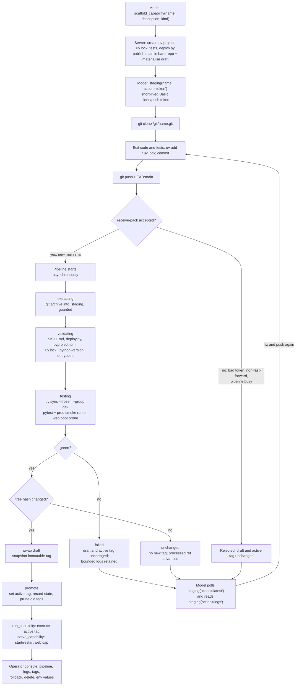

<p align="center">
  <a href="README.md">English</a> · <a href="README_it.md">Italiano</a>
</p>

<h1 align="center">capforge</h1>

<p align="center">
  <em>Deterministic, versioned capabilities exposed over MCP, for Open WebUI + Open Terminal.</em>
</p>

<p align="center">
  
  
  
  
</p>

<p align="center">
  <a href="docs/ARCHITECTURE.md">Architecture</a> ·
  <a href="docs/NEXT.md">Known limitations</a> ·
  <a href="#publish-flow">Publish flow</a>
</p>

---

The model scaffolds a capability as a **uv project**, publishes it as a git repository, clones it
into its own workspace, edits, and pushes. Capforge tests the pushed tree in a state-owned uv
environment and promotes it to an immutable tag on green. `run_capability` executes the active tag.
There is no shared filesystem between the terminal and the server. Cross-capability folders are
explicit, operator-approved shared volumes declared in `deploy.py`.

A capability whose `KIND` includes `"web"` in `deploy.py` is a long-lived ASGI service. It is
reverse-proxied at `http://<host>:8080/cap/<name>/`; the console is `/ui/`, the control API is
`/api/`, and the git smart-HTTP ingress is `/git/<name>.git`.

> [!NOTE]
> Capabilities are authored through git. The server owns drafts, versions, venvs and state; the
> model only sees its clone (or `get_capability`).

## Contents

- [Publish flow](#publish-flow)
- [Shape](#shape)
- [Install](#install)
- [Run](#run)
- [Environment](#environment)
- [Capability environment](#capability-environment)
- [MCP authentication](#mcp-authentication)
- [Docker](#docker)
- [The ten tools](#the-ten-tools)
- [Capability contract](#capability-contract)
- [Git authentication](#git-authentication)
- [Web capabilities](#web-capabilities)
- [Storage](#storage)
- [Tests](#tests)

## Publish flow



The HTTP push response is git's own report; promotion happens in a background pipeline. Poll
`staging(name, action="latest")` for the terminal state (`promoted`, `unchanged`, `failed`,
`interrupted`) and use `staging(name, action="logs")` for diagnostics. A failed push never moves the
active tag.

## Shape

- Fixed MCP surface of **ten tools**; capabilities live behind it.
- One draft per capability, immutable tags, JSON state, per-requirement uv venvs.
- Git clone/push is the authoring path; `scaffold_capability` creates the base repo.
- Python is fixed at **3.14**; dependencies come from the project's `pyproject.toml` and
  `uv.lock` (`uv sync --frozen`).
- Landlock confines capability and web children to their own code/venv, system libraries, their
  data directories and approved shared folders. Git/uv children are tracked but not yet under
  Landlock (see `docs/NEXT.md`).
- Per-capability pipeline/scaffold/served logs are bounded and exposed through MCP actions.
- Operator-managed environment values are stored per capability and edited only in the console;
  the model declares `Env` fields in `deploy.py` but never reads or writes values.
- Shared folders are operator-owned volumes. A capability declares `SHARES`; the operator
  approves `ro`/`rw` in the console, with a census of folders and grantees.

## Install

Requires **Python 3.14**, **uv**, **git**, and — only to rebuild the console — **bun**.

```sh
uv sync
cd ui && bun install --frozen-lockfile && bun run build   # optional console
```

## Run

```sh
export CAPFORGE_MCP_TOKEN="$(openssl rand -hex 32)"
uv run capforge doctor                   # paths, uv, git, Landlock, fastmcp, listeners
uv run capforge serve                    # MCP :8099/mcp + web :8080
uv run capforge serve --transport stdio  # local MCP client (no web listener, no token)
uv run capforge tools                    # ten tool schemas
```

> [!IMPORTANT]
> HTTP MCP requires `CAPFORGE_MCP_TOKEN`; clients send `Authorization: Bearer <token>`. The web
> listener is required for clone/push and the console: `CAPFORGE_WEB_PORT=0` disables `/ui/`,
> `/api/`, `/git/` and `/cap/`.

## Environment

| variable | default | meaning |
|---|---|---|
| `CAPFORGE_CAPS_DIR` | `~/.agents/skills` | server-owned drafts; not shared with the terminal |
| `CAPFORGE_STATE_DIR` | `~/.capforge` | versions, venvs, data, git repos, staging, logs, locks |
| `CAPFORGE_KEEP_TAGS` | `5` | tags kept; the active tag is never pruned |
| `CAPFORGE_RUN_TIMEOUT` | `120` | seconds per `run_capability` |
| `CAPFORGE_TEST_TIMEOUT` | `300` | seconds per pipeline test |
| `CAPFORGE_INSTALL_TIMEOUT` | `240` | seconds per `uv lock`/`uv sync` |
| `CAPFORGE_SERVE_BOOT_TIMEOUT` | `60` | web boot budget |
| `CAPFORGE_GIT_TIMEOUT` | `300` | git CGI, pack transfer and `git archive` budget |
| `CAPFORGE_SANDBOX` | `require` | Landlock `require` / `warn` / `off` |
| `CAPFORGE_GIT_TOKEN_TTL` | `600` | clone/push token lifetime |
| `CAPFORGE_MAX_UPLOAD_BYTES` | 64 MiB | push spool / `receive.maxInputSize` |
| `CAPFORGE_LOG_MAX_BYTES` / `_TAIL_BYTES` | 1 MiB / 64 KiB | log rotation and MCP tail |
| `CAPFORGE_WEB_HOST` / `_WEB_PORT` | `0.0.0.0` / `8080` | web listener; `0` disables `/ui`, `/api`, `/git` and `/cap` |
| `CAPFORGE_PUBLIC_URL` | derived | externally reachable base, including any proxy prefix |
| `CAPFORGE_WEB_TOKEN` | unset | console/control token; unset disables `/api` |
| `CAPFORGE_WEB_UI` / `_UI_DIR` | `1` / `ui/dist` | console bundle or JSON index |
| `CAPFORGE_MCP_TOKEN` | required | bearer token for HTTP MCP (`stdio` exempt) |
| `CAPFORGE_HOST` / `_PORT` / `_PATH` | `0.0.0.0` / `8099` / `/mcp` | MCP transport |
| `CAPFORGE_LOG_LEVEL` | `INFO` | server log verbosity |
| `PUID` / `PGID` | `10001` | container user remap |

## Capability environment

A capability declares the variables it reads as fields of a pydantic `Env` model in `deploy.py`:

```python
from pydantic import BaseModel, Field


class Env(BaseModel):
    WEATHER_API_KEY: str
    TIMEOUT_SECONDS: int = 30
    # SMTP_PASSWORD: str = Field(min_length=1, description="SMTP password")
```

Fields may be `str`, `int`, `float` or `bool`; unknown annotations are treated as `str`. A field
without a default is required. `Field(...)` can add `description`, `min_length`/`max_length` and
`ge`/`le`. Capforge parses `deploy.py` statically (`ast`), never by importing it.

The model can only declare names. The operator sets values in the console (`/ui/`), which
requires `CAPFORGE_WEB_TOKEN`. Values live in `<state>/secrets/<name>.json` (mode `0600`),
are never returned by `/api`, and are shared across that capability's tags. Only declared
names are injected, and only into the active tag's process; optional fields fall back to their
declared default, and pipeline tests and the web boot probe receive the default or a type-shaped
placeholder (`capforge-test-placeholder`, `0`, `0.0`, `false`). The console validates the declared
type before storing. Changing a value restarts a running web instance. Capability code can still
read the values it is given at runtime; only store credentials you trust that capability to use.

> [!WARNING]
> Values are available to the capability at runtime. Treat the `Env` model as a trust boundary
> around operator-provided secrets, not as a sandbox around model-authored code.

## MCP authentication

HTTP MCP requires a bearer token:

```sh
export CAPFORGE_MCP_TOKEN="$(openssl rand -hex 32)"
uv run capforge serve
```

Open WebUI's MCP server entry must send `Authorization: Bearer <token>`. `--transport stdio` is
local and does not need a token. The token is never passed to capability children.

`/ui`, `/api`, `/git` and `/cap` share the web listener. The proxy strips cookies, authorization
headers and upstream `Set-Cookie`. If you serve untrusted web capabilities, put `/cap` on a
different origin at the reverse proxy; see `docs/NEXT.md`.

## Docker

```sh
mkdir -p caps state
CAPFORGE_MCP_TOKEN=$(openssl rand -hex 32) \
  PUID=$(id -u) PGID=$(id -g) docker compose up --build
```

`docker-compose.yml` publishes `:8099` (MCP) and `:8080` (web), and mounts:

- `./caps` → `/var/lib/capforge/caps` (server-owned drafts/repos)
- `./state` → `/var/lib/capforge/state` (versions, venvs, data, git, staging, logs, locks)

There is no terminal mount. The entrypoint remaps the user, chowns the mounts and drops privileges.
With `--user`/rootless Docker, pre-chown the mounts. The image healthcheck probes
`http://127.0.0.1:8080/readyz`; override it if you set `CAPFORGE_WEB_PORT=0`.

## The ten tools

| tool | purpose |
|---|---|
| `get_contract` | layout, git/uv loop, limits and rules; read first |
| `list_capabilities` | name, description, active tag, draft state, git URL |
| `get_capability` | draft details, active tag, tags, data mode |
| `scaffold_capability` | create the uv base project and bare repo; refuse an existing name |
| `run_capability` | execute the active tag (or scaffold draft before first promotion) |
| `serve_capability` | `start/stop/restart/status/logs` a web capability's active tag |
| `staging` | `token` (Basic clone/push), `latest` (pipeline + log tail), `logs` |
| `delete_capability` | request deletion (stop + revoke tokens; `confirm` must equal the name); an operator purges |
| `rollback_capability` | move the active pointer; no draft or repo change |
| `list_tags` | tags, active marker, optional draft diff |

Promotion and testing are pipeline-only. `capforge promote`/`capforge test` are operator recovery
commands; they are not MCP tools.

`delete_capability` is a deletion request, not an irreversible model action. Pending capabilities
are stopped and cannot run, serve, push or mint tokens; an operator purges them in the console or
with `capforge delete`, or cancels the request with `capforge cancel-delete`.

## Capability contract

```text
<name>/
    SKILL.md            name, description and instructions
    deploy.py           deployment descriptor: KIND, CLI_ENTRYPOINT,
                        WEB_ENTRYPOINT, APP, DATA, SHARES, Env
    pyproject.toml      requires-python = ">=3.14,<3.15"; dependencies
    uv.lock             committed; uv sync --frozen is the only install path
    .python-version     3.14
    main.py | app.py    CLI entrypoint and/or ASGI app
    tests/              pytest; the dev group also has pytest-cov
    AGENTS.md           the clone/edit/push loop (CLI and web)
```

`deploy.py` is the machine-readable contract:

```python
KIND = ["cli"]                 # "cli", "web", or ["cli", "web"]
CLI_ENTRYPOINT = "main.py"     # required when KIND includes "cli"
WEB_ENTRYPOINT = "app.py"      # required when KIND includes "web"
DATA = "version"               # "version" or "shared"
APP = "app"                    # web only; the ASGI object
SHARES = {                     # operator-approved cross-capability folders
    "datasets": "ro",
    "cache": "rw",
}
```

`KIND` lists the surfaces the capability exposes. `CLI_ENTRYPOINT` is the JSON
entrypoint, `WEB_ENTRYPOINT` plus `APP` describe the ASGI app, and a hybrid lists
both modes and declares both entrypoints. The declared entrypoints must match the
modes. `ENTRYPOINT` was renamed to `CLI_ENTRYPOINT`/`WEB_ENTRYPOINT`.

`SKILL.md` frontmatter carries only `name` and `description`; the deployment fields live in
`deploy.py`. The CLI entrypoint reads **one JSON object on stdin** and writes **one JSON value on
stdout**, exit 0. Diagnostics go to stderr. `{"error": "..."}` is a handled failure. A non-zero
exit, timeout or unparseable output is a failed call.

pytest-cov only sees the pytest process, so a raw `python main.py` subprocess reports 0% coverage.
The scaffold tests `handle()` directly and executes the real entrypoint in-process with
`runpy.run_path(..., run_name="__main__")`, then keeps one subprocess test for the stdin/stdout
contract. Keep `main.py` module-level code side-effect free because it runs again under `runpy`.

Runtime files go only under `CAPFORGE_DATA_DIR` (per version). Set `DATA = "shared"` in `deploy.py`
for a stable `CAPFORGE_SHARED_DATA_DIR` across tags; it is unversioned, and the capability owns
concurrency, migrations and backup. Code trees are not writable. Landlock denies state, tokens,
other capabilities, home, `/proc`, `/sys` and everything not explicitly allowed. Network, CPU and
memory are not confined.

### Shared folders

`SHARES` requests named folders shared with other capabilities:

```python
SHARES = {"datasets": "ro", "index-cache": "rw"}
```

The declaration is only a request. The console at `/ui/` shows a census of folders, grants and
pending requests; only the operator can approve, change or revoke access. Approved folders are
injected as one JSON variable:

```json
CAPFORGE_SHARES={"datasets":{"path":"/.../shares/datasets","access":"ro"}}
```

`ro` is enforced by Landlock; `rw` permits create, update and delete. An unapproved declaration, or
a grant that differs from the request, fails `run_capability`/`serve_capability` closed. Grants are per
capability and shared across its tags. Tests and the web boot probe receive fresh empty temporary
directories, never production data. Shared folders are unversioned and unsynchronized: use
`flock`/SQLite when concurrent calls can race, and treat backups and quotas as operator work. A
capability deletion revokes its grants but keeps the folder; a folder can only be deleted after
every grant is revoked.

`DATA = "shared"` is separate: it is that capability's own durable directory and no other
capability can reach it.

Served web apps are booted with uvicorn `--root-path /cap/<name>` and receive
`CAPFORGE_ROOT_PATH`. Do not pass `root_path=` to `FastAPI(...)`; it is deprecated. Read the env
value when code needs the prefix for absolute links.

## Git authentication

`staging(name, action="token")` returns a short-lived token and `basic_username`. Authentication is
HTTP Basic only; use the actor id as the username and the token as the password:

```sh
git -c credential.helper='!f() { echo "username=$BASIC_USERNAME"; echo "password=$TOKEN"; }; f' \
  clone "$GIT_URL"
```

`CAPFORGE_GIT_CHECK_USER=1` (default) requires the username to equal the token actor id. Bearer is
not accepted. Do not put the token in the URL. Clone and push use the same token.

## Web capabilities

A `KIND` that includes `"web"` requires `uvicorn` in `[project].dependencies`, `WEB_ENTRYPOINT`
and an ASGI `APP`. After a green push, `serve_capability(name, action="start")` boots the active
tag at `/cap/<name>/`. `restart` picks up a newly promoted tag; promotion alone does not restart it.
A hybrid (`KIND = ["cli", "web"]`) also keeps `run_capability` on `CLI_ENTRYPOINT`.
Boot failures return the child log tail. The child is sandboxed by Landlock and writes only to
its data directories and approved shared folders.

## Storage

```text
<CAPFORGE_CAPS_DIR>/<name>/                   derived draft (last accepted push)
<CAPFORGE_STATE_DIR>/versions/<name>/<tag>/   immutable snapshots
<CAPFORGE_STATE_DIR>/venvs/<name>/<lock>-py314[-test]/
<CAPFORGE_STATE_DIR>/data/<name>/<tag>/       per-version data (pruned with the tag)
<CAPFORGE_STATE_DIR>/data/<name>/shared/      optional durable data (per capability)
<CAPFORGE_STATE_DIR>/shares/<folder>/         operator-owned cross-capability data
<CAPFORGE_STATE_DIR>/state/<name>.json        active tag + tags
<CAPFORGE_STATE_DIR>/state/shares.json        shared-folder census and grants
<CAPFORGE_STATE_DIR>/staging/<name>.json      push pipeline state
<CAPFORGE_STATE_DIR>/git/<name>.git/          bare receive/upload repository
<CAPFORGE_STATE_DIR>/logs/<name>/*.log        pipeline/scaffold logs
<CAPFORGE_STATE_DIR>/served/registry.json     web desired state
<CAPFORGE_STATE_DIR>/served/<name>/<tag>/server.log
<CAPFORGE_STATE_DIR>/locks/                   per-capability/venv/push/pipeline locks
```

The capability repository is the code history. State plus `refs/capforge/processed` is the
promotion record; there is no separate caps-root audit repo.

## Tests

```sh
uv run --locked pytest -q -m "not slow"
uv run --locked pytest -q --cov=capforge --cov-branch --cov-fail-under=71
uv run --locked ruff check .
uv run --locked mypy capforge
```

pytest runs under xdist (`-n auto`) by default; pass `-n0` for a serial run.

The fast suite covers parsing, validation, state, routes, console auth, sandbox policy and the
ten-tool surface. The slow suite builds real uv envs, git repos, uvicorn children and a real
clone/push pipeline.
