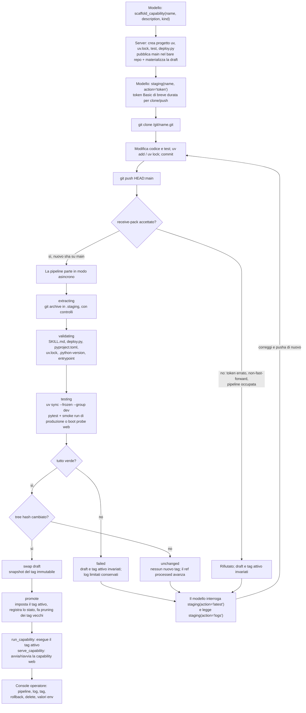

<p align="center">
  <a href="README.md">English</a> · <a href="README_it.md">Italiano</a>
</p>

<h1 align="center">capforge</h1>

<p align="center">
  <em>Capability deterministiche e versionate, esposte via MCP, per Open WebUI + Open Terminal.</em>
</p>

<p align="center">
  
  
  
  
</p>

<p align="center">
  <a href="docs/ARCHITECTURE.md">Architettura</a> ·
  <a href="docs/NEXT.md">Limiti noti</a> ·
  <a href="#flusso-di-pubblicazione">Flusso di pubblicazione</a>
</p>

---

Il modello crea lo scheletro di una capability come **progetto uv**, la pubblica come repository
git, la clona nel proprio workspace, la modifica e la pusha. Capforge testa l'albero pushato in un
ambiente uv di proprietà dello stato e, se tutto è verde, lo promuove a un tag immutabile.
`run_capability` esegue il tag attivo. Non esiste un filesystem condiviso tra terminale e server.
Le cartelle tra capability sono volumi espliciti, dichiarati in `deploy.py` e approvati
dall'operatore.

Una capability il cui `KIND` include `"web"` in `deploy.py` è un servizio ASGI long-lived. È reverse-proxied
su `http://<host>:8080/cap/<name>/`; la console è `/ui/`, l'API di controllo è `/api/` e l'ingresso
git smart-HTTP è `/git/<name>.git`.

> [!NOTE]
> Le capability si scrivono tramite git. Il server possiede draft, versioni, venv e stato; il
> modello vede solo il proprio clone (o `get_capability`).

## Indice

- [Flusso di pubblicazione](#flusso-di-pubblicazione)
- [Struttura](#struttura)
- [Installazione](#installazione)
- [Avvio](#avvio)
- [Variabili d'ambiente](#variabili-dambiente)
- [Ambiente della capability](#ambiente-della-capability)
- [Autenticazione MCP](#autenticazione-mcp)
- [Docker](#docker)
- [I dieci tool](#i-dieci-tool)
- [Contratto della capability](#contratto-della-capability)
- [Autenticazione Git](#autenticazione-git)
- [Capability web](#capability-web)
- [Archiviazione](#archiviazione)
- [Test](#test)

## Flusso di pubblicazione



La risposta HTTP della push è il report di git; la promozione avviene in una pipeline in background.
Interroga `staging(name, action="latest")` per lo stato terminale (`promoted`, `unchanged`, `failed`,
`interrupted`) e usa `staging(name, action="logs")` per la diagnostica. Una push fallita non sposta
mai il tag attivo.

## Struttura

- Superficie MCP fissa di **dieci tool**; le capability vivono dietro di essa.
- Una draft per capability, tag immutabili, stato JSON, venv uv per requisito.
- Clone/push git è il percorso di authoring; `scaffold_capability` crea il repository base.
- Python è fissato a **3.14**; le dipendenze vengono da `pyproject.toml` e `uv.lock` del progetto
  (`uv sync --frozen`).
- Landlock confina le capability e i child web al proprio codice/venv, alle librerie di sistema,
  alle directory dati e alle cartelle condivise approvate. I child git/uv sono tracciati ma non
  ancora sotto Landlock (vedi `docs/NEXT.md`).
- I log per capability di pipeline/scaffold/served sono limitati ed esposti tramite azioni MCP.
- I valori ambiente gestiti dall'operatore sono memorizzati per capability e modificati solo dalla
  console; il modello dichiara i campi `Env` in `deploy.py` ma non legge né scrive mai i valori.
- Le cartelle condivise sono volumi dell'operatore: la capability dichiara `SHARES`, l'operatore
  approva `ro`/`rw` dalla console, che mostra cartelle e grant.

## Installazione

Richiede **Python 3.14**, **uv**, **git** e — solo per ricostruire la console — **bun**.

```sh
uv sync
cd ui && bun install --frozen-lockfile && bun run build   # console opzionale
```

## Avvio

```sh
export CAPFORGE_MCP_TOKEN="$(openssl rand -hex 32)"
uv run capforge doctor                    # percorsi, uv, git, Landlock, fastmcp, listener
uv run capforge serve                     # MCP :8099/mcp + web :8080
uv run capforge serve --transport stdio   # client MCP locale (nessun listener web, nessun token)
uv run capforge tools                     # schema dei dieci tool
```

> [!IMPORTANT]
> MCP HTTP richiede `CAPFORGE_MCP_TOKEN`; i client inviano `Authorization: Bearer <token>`. Il
> listener web è necessario per clone/push e per la console: `CAPFORGE_WEB_PORT=0` disabilita
> `/ui/`, `/api/`, `/git/` e `/cap/`.

## Variabili d'ambiente

| variabile | default | significato |
|---|---|---|
| `CAPFORGE_CAPS_DIR` | `~/.agents/skills` | draft di proprietà del server; non condivise con il terminale |
| `CAPFORGE_STATE_DIR` | `~/.capforge` | versioni, venv, dati, repository git, staging, log, lock |
| `CAPFORGE_KEEP_TAGS` | `5` | tag conservati; il tag attivo non viene mai potato |
| `CAPFORGE_RUN_TIMEOUT` | `120` | secondi per `run_capability` |
| `CAPFORGE_TEST_TIMEOUT` | `300` | secondi per il test della pipeline |
| `CAPFORGE_INSTALL_TIMEOUT` | `240` | secondi per `uv lock`/`uv sync` |
| `CAPFORGE_SERVE_BOOT_TIMEOUT` | `60` | budget di boot web |
| `CAPFORGE_GIT_TIMEOUT` | `300` | budget per git CGI, trasferimento pack e `git archive` |
| `CAPFORGE_SANDBOX` | `require` | Landlock `require` / `warn` / `off` |
| `CAPFORGE_GIT_TOKEN_TTL` | `600` | durata del token clone/push |
| `CAPFORGE_MAX_UPLOAD_BYTES` | 64 MiB | spool push / `receive.maxInputSize` |
| `CAPFORGE_LOG_MAX_BYTES` / `_TAIL_BYTES` | 1 MiB / 64 KiB | rotazione log e tail MCP |
| `CAPFORGE_WEB_HOST` / `_WEB_PORT` | `0.0.0.0` / `8080` | listener web; `0` disabilita `/ui`, `/api`, `/git` e `/cap` |
| `CAPFORGE_PUBLIC_URL` | derivato | base raggiungibile dall'esterno, incluso un eventuale prefisso proxy |
| `CAPFORGE_WEB_TOKEN` | non impostato | token console/control; se assente disabilita `/api` |
| `CAPFORGE_WEB_UI` / `_UI_DIR` | `1` / `ui/dist` | bundle della console o indice JSON |
| `CAPFORGE_MCP_TOKEN` | richiesto | token bearer per MCP HTTP (`stdio` esente) |
| `CAPFORGE_HOST` / `_PORT` / `_PATH` | `0.0.0.0` / `8099` / `/mcp` | trasporto MCP |
| `CAPFORGE_LOG_LEVEL` | `INFO` | verbosità dei log del server |
| `PUID` / `PGID` | `10001` | rimappatura dell'utente nel container |

## Ambiente della capability

Una capability dichiara le variabili che legge come campi di un modello pydantic `Env` in
`deploy.py`:

```python
from pydantic import BaseModel, Field


class Env(BaseModel):
    WEATHER_API_KEY: str
    TIMEOUT_SECONDS: int = 30
    # SMTP_PASSWORD: str = Field(min_length=1, description="SMTP password")
```

I campi possono essere `str`, `int`, `float` o `bool`; le annotazioni sconosciute sono trattate
come `str`. Un campo senza default è obbligatorio. `Field(...)` può aggiungere `description`,
`min_length`/`max_length` e `ge`/`le`. Capforge analizza `deploy.py` staticamente (`ast`), mai
importandolo.

Il modello può solo dichiarare nomi. L'operatore imposta i valori nella console (`/ui/`), che
richiede `CAPFORGE_WEB_TOKEN`. I valori vivono in `<state>/secrets/<name>.json` (permessi `0600`),
non vengono mai restituiti da `/api` e sono condivisi tra i tag di quella capability. Solo i nomi
dichiarati vengono iniettati, e solo nel processo del tag attivo; i campi opzionali usano il default
dichiarato, mentre i test della pipeline e il boot probe web ricevono il default o un placeholder
tipizzato (`capforge-test-placeholder`, `0`, `0.0`, `false`). La console valida il tipo dichiarato
prima di memorizzare. Cambiare un valore riavvia un'istanza web in esecuzione. Il codice della
capability può comunque leggere i valori che riceve a runtime; memorizza solo credenziali di cui ti
fidi per quella capability.

> [!WARNING]
> I valori sono disponibili alla capability a runtime. Considera il modello `Env` come confine di
> fiducia attorno ai segreti forniti dall'operatore, non come sandbox per il codice scritto dal
> modello.

## Autenticazione MCP

MCP HTTP richiede un token bearer:

```sh
export CAPFORGE_MCP_TOKEN="$(openssl rand -hex 32)"
uv run capforge serve
```

La voce del server MCP in Open WebUI deve inviare `Authorization: Bearer <token>`.
`--transport stdio` è locale e non richiede token. Il token non viene mai passato ai child delle
capability.

`/ui`, `/api`, `/git` e `/cap` condividono il listener web. Il proxy rimuove cookie, header di
autorizzazione e `Set-Cookie` provenienti dall'upstream. Se servi capability web non fidate, esponi
`/cap` su un'origine diversa nel reverse proxy; vedi `docs/NEXT.md`.

## Docker

```sh
mkdir -p caps state
CAPFORGE_MCP_TOKEN=$(openssl rand -hex 32) \
  PUID=$(id -u) PGID=$(id -g) docker compose up --build
```

`docker-compose.yml` pubblica `:8099` (MCP) e `:8080` (web) e monta:

- `./caps` → `/var/lib/capforge/caps` (draft/repo di proprietà del server)
- `./state` → `/var/lib/capforge/state` (versioni, venv, dati, git, staging, log, lock)

Non c'è alcun mount del terminale. L'entrypoint rimappa l'utente, cambia il proprietario dei mount e
rilascia i privilegi. Con `--user`/Docker rootless, imposta prima il proprietario dei mount.
L'healthcheck dell'immagine verifica `http://127.0.0.1:8080/readyz`; sovrascrivilo se imposti
`CAPFORGE_WEB_PORT=0`.

## I dieci tool

| tool | scopo |
|---|---|
| `get_contract` | layout, loop git/uv, limiti e regole; leggi per primo |
| `list_capabilities` | nome, descrizione, tag attivo, stato della draft, URL git |
| `get_capability` | dettagli della draft, tag attivo, tag, modalità dati |
| `scaffold_capability` | crea il progetto base uv e il bare repo; rifiuta un nome esistente |
| `run_capability` | esegue il tag attivo (o la draft scaffold prima della prima promozione) |
| `serve_capability` | `start/stop/restart/status/logs` del tag attivo di una capability web |
| `staging` | `token` (clone/push Basic), `latest` (pipeline + tail log), `logs` |
| `delete_capability` | ferma ed elimina una capability e tutto lo stato server; `confirm` deve coincidere con il nome |
| `rollback_capability` | sposta il puntatore attivo; non modifica draft o repository |
| `list_tags` | tag, marcatore attivo, diff opzionale rispetto alla draft |

Promozione e test avvengono solo nella pipeline. `capforge promote`/`capforge test` sono comandi di
recupero per l'operatore; non sono tool MCP.

## Contratto della capability

```text
<name>/
    SKILL.md            nome, descrizione e istruzioni
    deploy.py           descrittore: KIND, CLI_ENTRYPOINT, WEB_ENTRYPOINT,
                        APP, DATA, SHARES, Env
    pyproject.toml      requires-python = ">=3.14,<3.15"; dipendenze
    uv.lock             committato; uv sync --frozen è l'unico percorso di installazione
    .python-version     3.14
    main.py | app.py    entrypoint CLI e/o app ASGI
    tests/              pytest; il gruppo dev include anche pytest-cov
    AGENTS.md           il loop clone/edit/push (CLI e web)
```

`deploy.py` è il contratto leggibile dalla macchina:

```python
KIND = ["cli"]                 # "cli", "web", oppure ["cli", "web"]
CLI_ENTRYPOINT = "main.py"     # richiesto quando KIND include "cli"
WEB_ENTRYPOINT = "app.py"      # richiesto quando KIND include "web"
DATA = "version"               # "version" oppure "shared"
APP = "app"                    # solo web; l'oggetto ASGI
SHARES = {                     # cartelle cross-capability approvate dall'operatore
    "datasets": "ro",
    "cache": "rw",
}
```

`KIND` elenca le superfici esposte. `CLI_ENTRYPOINT` è l'entrypoint JSON,
`WEB_ENTRYPOINT` più `APP` descrivono l'app ASGI, e un ibrido elenca entrambe le
modalità e dichiara entrambi gli entrypoint. Gli entrypoint devono corrispondere
alle modalità. `ENTRYPOINT` è stato rinominato in
`CLI_ENTRYPOINT`/`WEB_ENTRYPOINT`.

Il frontmatter di `SKILL.md` contiene solo `name` e `description`; i campi di deployment vivono in
`deploy.py`. L'entrypoint CLI legge **un oggetto JSON su stdin** e scrive **un valore JSON su
stdout**, exit 0. La diagnostica va su stderr. `{"error": "..."}` è un fallimento gestito. Un exit
non zero, un timeout o un output non parsabile sono una chiamata fallita.

pytest-cov vede solo il processo pytest, quindi un sottoprocesso `python main.py` risulta allo 0%.
I test dello scaffold chiamano `handle()` direttamente ed eseguono l'entrypoint reale in-process
con `runpy.run_path(..., run_name="__main__")`, mantenendo un test di sottoprocesso per il
contratto stdin/stdout. Il codice a livello di modulo deve essere privo di effetti collaterali,
perché viene eseguito di nuovo da `runpy`.

I file runtime vanno solo sotto `CAPFORGE_DATA_DIR` (per versione). Imposta `DATA = "shared"` in
`deploy.py` per una `CAPFORGE_SHARED_DATA_DIR` stabile tra i tag; non è versionata e la capability è
responsabile di concorrenza, migrazioni e backup. Gli alberi di codice non sono scrivibili. Landlock
nega stato, token, altre capability, home, `/proc`, `/sys` e tutto ciò che non è esplicitamente
consentito. Rete, CPU e memoria non sono confinate.

### Cartelle condivise

`SHARES` richiede cartelle condivise tra capability:

```python
SHARES = {"datasets": "ro", "index-cache": "rw"}
```

La dichiarazione è solo una richiesta. La console `/ui/` mostra il censimento di cartelle, grant e
richieste in attesa; solo l'operatore può approvare, cambiare o revocare l'accesso. Le cartelle
approvate arrivano in un'unica variabile JSON:

```json
CAPFORGE_SHARES={"datasets":{"path":"/.../shares/datasets","access":"ro"}}
```

`ro` è applicato da Landlock; `rw` consente creazione, modifica e cancellazione. Una dichiarazione
non approvata, o un grant più debole della richiesta, fa fallire `run_capability`/`serve_capability`.
I grant sono per capability e valgono per tutti i suoi tag. Test e boot probe ricevono directory
temporanee vuote, mai i dati di produzione. Le cartelle condivise non sono versionate né
sincronizzate: usa `flock`/SQLite per la concorrenza; backup e quote restano all'operatore. La
cancellazione di una capability revoca i suoi grant ma conserva la cartella; una cartella si può
cancellare solo dopo aver revocato tutti i grant.

`DATA = "shared"` è separato: è la directory durevole della singola capability e nessun'altra
capability può accedervi.

Le app web servite vengono avviate con uvicorn `--root-path /cap/<name>` e ricevono
`CAPFORGE_ROOT_PATH`. Non passare `root_path=` a `FastAPI(...)`; è deprecato. Leggi la variabile
d'ambiente quando il codice ha bisogno del prefisso per link assoluti.

## Autenticazione Git

`staging(name, action="token")` restituisce un token di breve durata e `basic_username`.
L'autenticazione è solo HTTP Basic; usa l'id dell'attore come username e il token come password:

```sh
git -c credential.helper='!f() { echo "username=$BASIC_USERNAME"; echo "password=$TOKEN"; }; f' \
  clone "$GIT_URL"
```

`CAPFORGE_GIT_CHECK_USER=1` (default) richiede che lo username coincida con l'id dell'attore del
token. Bearer non è accettato. Non inserire il token nell'URL. Clone e push usano lo stesso token.

## Capability web

Un `KIND` che include `"web"` richiede `uvicorn` in `[project].dependencies`, `WEB_ENTRYPOINT` e
un `APP` ASGI. Dopo una push verde, `serve_capability(name, action="start")` avvia il tag attivo su
`/cap/<name>/`. `restart` adotta un tag appena promosso; la sola promozione non lo riavvia. Un
ibrido (`KIND = ["cli", "web"]`) mantiene anche `run_capability` su `CLI_ENTRYPOINT`. I fallimenti
di boot restituiscono il tail del log del child. Il child è confinato da Landlock e scrive solo
nelle proprie directory dati e nelle cartelle condivise approvate.

## Archiviazione

```text
<CAPFORGE_CAPS_DIR>/<name>/                   draft derivata (ultima push accettata)
<CAPFORGE_STATE_DIR>/versions/<name>/<tag>/   snapshot immutabili
<CAPFORGE_STATE_DIR>/venvs/<name>/<lock>-py314[-test]/
<CAPFORGE_STATE_DIR>/data/<name>/<tag>/       dati per versione (potati con il tag)
<CAPFORGE_STATE_DIR>/data/<name>/shared/      dati opzionali e durevoli (per capability)
<CAPFORGE_STATE_DIR>/shares/<folder>/         dati cross-capability dell'operatore
<CAPFORGE_STATE_DIR>/state/<name>.json        tag attivo + tag
<CAPFORGE_STATE_DIR>/state/shares.json        censimento cartelle e grant
<CAPFORGE_STATE_DIR>/staging/<name>.json      stato della pipeline di push
<CAPFORGE_STATE_DIR>/git/<name>.git/          repository bare receive/upload
<CAPFORGE_STATE_DIR>/logs/<name>/*.log        log di pipeline/scaffold
<CAPFORGE_STATE_DIR>/served/registry.json     stato desiderato delle web servite
<CAPFORGE_STATE_DIR>/served/<name>/<tag>/server.log
<CAPFORGE_STATE_DIR>/locks/                   lock per capability/venv/push/pipeline
```

Il repository della capability è la storia del codice. Lo stato più `refs/capforge/processed` è il
registro delle promozioni; non esiste un repository di audit separato nella root delle capability.

## Test

```sh
uv run --locked pytest -q -m "not slow"
uv run --locked pytest -q --cov=capforge --cov-branch --cov-fail-under=71
uv run --locked ruff check .
uv run --locked mypy capforge
```

La suite veloce copre parsing, validazione, stato, route, autenticazione della console, policy di
sandbox e la superficie dei dieci tool. La suite lenta costruisce veri ambienti uv, repository git,
child uvicorn e una vera pipeline di clone/push.
