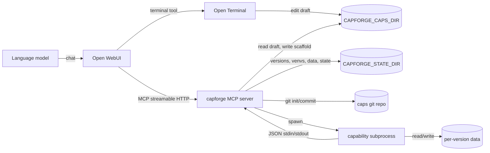
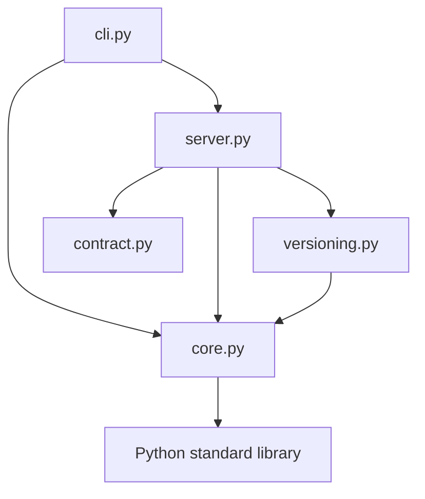
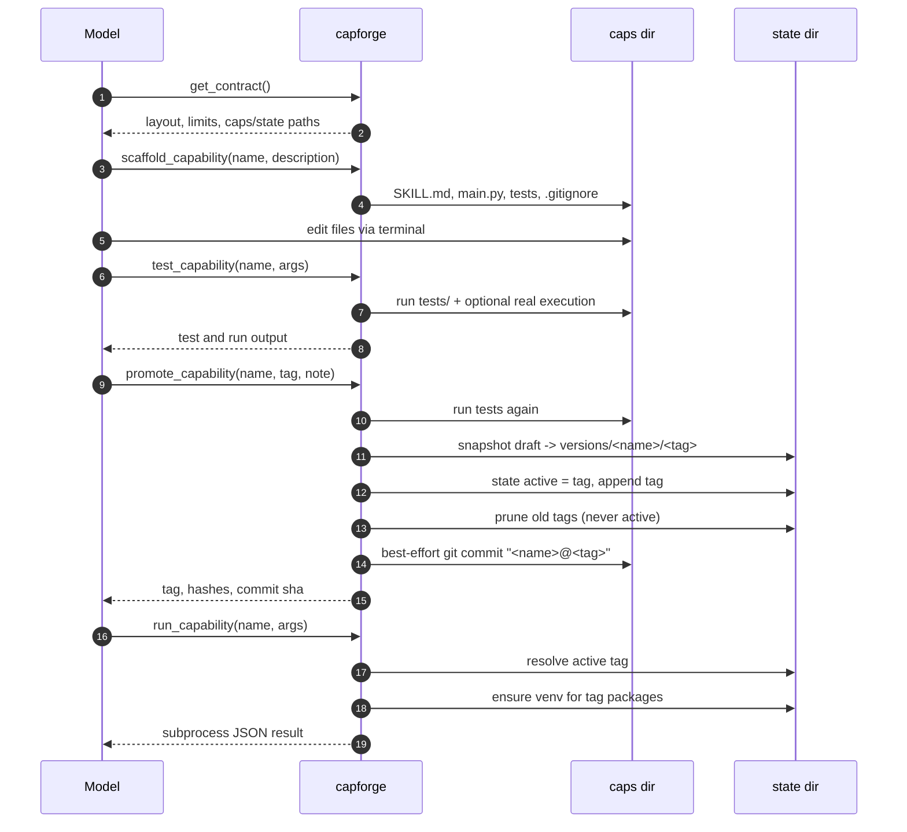

# Architecture

Status: describes `capforge` 0.1.0 as implemented. If code and this document disagree, the code
wins; update this file in the same change.

Related documents:

- [`README.md`](../README.md) — install, run, deployment and the public contract.
- [`AGENTS.md`](../AGENTS.md) — contributor rules, test strategy and definition of done.
- [`AGENTS.md.example`](../AGENTS.md.example) — the guide deployed into a capability workspace.

## 1. What capforge is

`capforge` is a small MCP server that lets a language model **write, test, version and execute
its own tools** without changing the MCP tool list. A capability is an ordinary folder of Python:

```
<caps>/<name>/
    SKILL.md            frontmatter + instructions, visible to the model every turn
    main.py             entrypoint (configurable)
    tests/test_main.py  optional
```

The model edits that folder through Open Terminal, runs it as a draft, promotes a tested snapshot
to an immutable tag, and from then on `run_capability(name, args)` executes the tagged version.
The working copy is never the thing that runs after promotion.

The design is intentionally small:

- one fixed MCP surface (ten tools), no tool-per-capability;
- one process per capability call, with a JSON stdin/stdout contract;
- one draft per capability, immutable versions outside it, state in JSON files;
- a separate virtualenv per requirement set;
- git as a best-effort audit log.

## 2. Constraints that shape the design

These constraints came from Open WebUI 0.12.x. They are product requirements, not implementation
details, and changing them invalidates most of the architecture.

| Constraint | Consequence |
|---|---|
| `tools/list` is resolved every message, but the tool list for a turn is fixed once the turn starts. | A newly created capability cannot appear as its own tool in the turn that created it. A dispatcher (`run_capability`) resolves the target at execution time, closing the loop within one turn. |
| Tools reach the model as `<server_id>_<tool_name>` and a changing set/description invalidates the provider prompt cache. | The MCP surface is fixed at ten stable tools. Capabilities live behind the surface. Adding or renaming a tool is a cache-invalidating breaking change. |
| Open WebUI re-reads terminal skills from `.agents/skills` (also `.cptr`, `.claude`, `.codex`) and `AGENTS.md` every turn. | `CAPFORGE_CAPS_DIR` points at that same folder, so capabilities appear in the per-turn manifest for free and the model edits exactly what the server executes. |
| Capability code is authored by a model. | Input validation, a promotion test gate, a filtered environment, per-capability venvs, timeouts, and deterministic-output rules are mandatory. |
| There is no safe place for provider credentials in capability code. | The execution environment is allowlisted down to PATH/locale/SSL/pip-index settings; secrets are absent by construction, not merely discouraged. |

## 3. System context



The caps directory is the only place where the terminal and capforge must agree. It is mounted at
the terminal's skills home in both containers (see [Deployment](#11-deployment-topology)).
`CAPFORGE_STATE_DIR` is server-owned and should be a separate volume.

## 4. Module architecture

```
capforge/
    __init__.py     __version__
    core.py         paths, validation, SKILL.md parsing, state JSON, hashing,
                    venv construction, process execution, test running
    versioning.py   snapshot, promote, prune, rollback, list_tags, diff, git audit
    contract.py     CONTRACT text and scaffold templates (strings only)
    server.py       FastMCP instance and the ten @mcp.tool functions
    cli.py          capforge serve | doctor | tools
```



Dependency rules:

- `core.py`, `versioning.py` and `contract.py` are **stdlib-only**. `core` has no knowledge of MCP.
- `server.py` is the only module that imports `fastmcp`. It is a thin adapter: argument handling,
  error normalization, response shaping.
- `versioning.py` depends on `core` (paths, hashes, state), never the reverse.
- `cli.py` imports `server` lazily inside command handlers, so `capforge doctor` works with a
  missing or broken `fastmcp` install.
- `contract.py` holds only strings, including the scaffold source; it has no logic.

This boundary is what makes the lifecycle testable through plain function calls and keeps the
capability contract independent of the transport.

## 5. Runtime flows

### 5.1 Discovery

`list_capabilities` scans `CAPFORGE_CAPS_DIR` once per call. Directories are candidates only if
the name matches `^[a-z][a-z0-9_]{0,63}$` and does not start with `.` or `_`. For each candidate:

1. Load `SKILL.md` if present. Missing file, missing `description`, or missing entrypoint becomes a
   per-capability `draft_error`, not a failed listing.
2. Read `<state>/state/<name>.json`.
3. Compute `draft_changed` by comparing the active `content_hash` with a fresh `tree_hash` of the
   draft.

The model's per-turn skill manifest is a separate mechanism: Open WebUI reads the folder directly.
`list_capabilities` is for the MCP caller and includes active-tag and draft-diff information.

### 5.2 Authoring and promotion



Promotion is the only transition from draft to runnable version. It is guarded by:

1. `draft_ready`: `SKILL.md` exists, has a `description`, and the entrypoint exists.
2. Tests pass (unless `skip_tests=true`), using the supplied package set if one is given.
3. The tag does not already exist. Tags are never overwritten.
4. The draft differs from the active content hash, unless `force=true`.

If a new `packages` list is supplied, it is written into `SKILL.md` **before** the snapshot, so the
tag carries the frontmatter its venv will be built from. Reordering that step changes what a
promoted version declares.

### 5.3 Execution

`run_capability` resolves a source, then calls `core.execute`:

| Active tag | Draft runnable | Source | `mode` |
|---|---|---|---|
| recorded and files exist | any | `<state>/versions/<name>/<tag>` | `active` |
| recorded but files missing | any | — | error: roll back or promote again |
| none | yes | `<caps>/<name>` | `draft` + `warning` |
| none | no | — | error |

Execution steps:

1. Select the package list: the active tag's recorded packages, otherwise the draft's.
2. Ensure `<state>/venvs/<name>/<requirements_hash>/` exists, installing the packages if needed.
3. Build an allowlisted environment and add `CAPFORGE_CAP`, `CAPFORGE_VERSION`,
   `CAPFORGE_DATA_DIR`, `VIRTUAL_ENV`, and a venv-prefixed `PATH`.
4. Run `<venv>/bin/python <entrypoint>` with `cwd` set to the source directory, one JSON object on
   stdin, and a hard timeout.
5. Parse stdout as JSON and return exit code, stdout/stderr tails, duration, and result.

The capability never receives argv. Diagnostics belong on stderr. A non-zero exit, a timeout, or
unparseable stdout is a failed call. A parsed `{"error": "..."}` is a **handled** failure: it is
returned as a successful MCP call whose `result` contains `error`, and the model is expected to
read it.

Implementation quirks worth knowing:

- `execute` parses the **entire trimmed stdout** as one JSON value. The contract text and scaffold
  test say "last line"; the implementation is stricter.
- Empty stdout with exit 0 is treated as success with `result: null`. The contract asks for a JSON
  value, so capabilities should always emit one.
- `test_capability` runs pytest when any `tests/test_*.py` exists; otherwise it performs a smoke
  run with `{}` on stdin. It reuses the draft, not the active tag.

### 5.4 Rollback and diff

`rollback_capability` updates only `state.active` to an existing tag after confirming the tag's
files exist. It does not copy files, touch the draft, or create a new tag. `list_tags` reports tags,
the active marker and pruned tags; `diff_against_active=true` shells out to
`git diff --no-index` between the active version directory and the draft.

## 6. Storage model

```
<CAPFORGE_CAPS_DIR>/<name>/                     draft: model-editable, git repo
<CAPFORGE_STATE_DIR>/versions/<name>/<tag>/     immutable snapshots
<CAPFORGE_STATE_DIR>/venvs/<name>/<hash>/       one venv per requirement set
<CAPFORGE_STATE_DIR>/data/<name>/<tag>/         writable per-version data
<CAPFORGE_STATE_DIR>/state/<name>.json          active tag + tag index + prune log
```

| Location | Owner | Mutability | Notes |
|---|---|---|---|
| caps draft | model / terminal / capforge | editable | The only source for `test_capability` and scaffolding. |
| versions | capforge | append-only by convention | Promotion refuses an existing tag. Filesystem permissions do not prevent direct edits. |
| venvs | capforge | build cache | Keyed by requirement hash; old venvs are kept for old tags. |
| data | capability process | writable | Per capability and per version; never shared between tags. |
| state JSON | capforge | read/write | The source of truth for the active pointer. |
| caps git repo | capforge | best effort | Initialized on first promotion; one commit per promotion. |

### 6.1 State JSON

```json
{
  "name": "wordcount",
  "active": {
    "tag": "v2",
    "path": "/var/lib/capforge/versions/wordcount/v2",
    "content_hash": "…",
    "created_at": 1760000000,
    "packages": ["six"],
    "requirements_hash": "…",
    "note": "what changed",
    "promoted_at": 1760000100,
    "previous": "v1"
  },
  "tags": ["… same shape …"],
  "pruned": [{"tag": "v1", "at": 1760000200}]
}
```

Writes are atomic: JSON is written to a sibling temp file and moved with `Path.replace`. Reads are
tolerant: missing or corrupt state yields an empty capability state rather than a crash. Note that
this means corrupt state can silently make an existing tag invisible; the version files remain on
disk.

### 6.2 Hashing

- `tree_hash(root)` — SHA-256 over the sorted relative path, a NUL, the file bytes, and another NUL
  for every regular file, ignoring `__pycache__`, `.git`, `.pytest_cache`, `.venv`, `venv`,
  `.mypy_cache`, `.ruff_cache`. It is the definition of "the draft changed".
- `requirements_hash(packages)` — SHA-256 of the newline-joined, sorted, deduplicated package list,
  truncated to 16 hex characters. It keys the venv cache.

Keep the `tree_hash` skip set and `versioning.SKIP` aligned; otherwise snapshots and change
detection disagree about what belongs to a capability.

## 7. Versioning semantics

- A **tag** is an immutable directory copy. Immutability is enforced by refusing to overwrite, not
  by filesystem permissions.
- The default tag is `v<n>-<YYYYmmdd-HHMMSS>`, where `n` is the current tag count plus one.
- Pruning keeps `CAPFORGE_KEEP_TAGS` (default 5) tags. The oldest non-active tag is removed first;
  the active tag is never pruned, even when it is the oldest.
- The pruned list in state grows without bound. It is an audit aid, not a retention policy.
- Git is best effort. A missing `git`, failed init, or failed commit does not fail a promotion.
- `rollback` is a pointer move. The draft stays whatever the model last wrote.
- `force=true` re-tags an unchanged draft; otherwise an identical draft returns
  `promoted: false`.
- `dry_run` in `versioning.promote` is internal and reports the hash and would-be prunes without
  writing.

Concurrency is **not** coordinated. State writes are atomic per file but there is no lock across a
read-modify-write cycle, so two simultaneous promotions/rollbacks for the same capability can lose
an update. Venv creation also uses a temp directory but no inter-process lock. Capability processes
sharing a version's data directory can race on files. This is acceptable for the current
single-operator deployment model; add per-capability locks before allowing concurrent mutation.

## 8. Execution environment and security

### 8.1 What is enforced

- One fresh subprocess per call. No long-lived capability process, no in-process import of
  capability code.
- A per-capability virtualenv selected by requirement hash. The venv's interpreter is the only
  interpreter used.
- `cwd` is the draft or the version directory, never `/` or the server's working directory.
- An environment allowlist: `PATH`, `LANG`, `LC_ALL`, `TZ`, `TERM`, `SSL_CERT_FILE`,
  `SSL_CERT_DIR`, `PIP_INDEX_URL`, `PIP_EXTRA_INDEX_URL`. `PYTHONPATH` and `PYTHONHOME` are
  removed. `CAPFORGE_*` values are set explicitly.
- A per-version data directory in `CAPFORGE_DATA_DIR`.
- A hard timeout per run and per test/install.
- Name and tag validation plus path containment for every server-side path derived from caller
  input.

### 8.2 What is **not** enforced

This is important when deciding what to host:

- **No OS-level sandbox.** Capabilities run as the same Unix user as the server. They can read any
  file that user can read and write anywhere that user can write, including other capabilities,
  versions and state. "Write only under `CAPFORGE_DATA_DIR`" is a contract rule, not a kernel
  boundary.
- **No network isolation.** "Assume no network" is a policy; egress is not blocked. A capability
  that makes HTTP calls will succeed if the host allows it.
- **No memory/CPU limits** beyond the wall-clock timeout. No process tree limits or cgroup.
- **No authentication** on the MCP endpoint. Put it on an internal network or terminate auth at a
  proxy.
- **No secret injection**, which is a control, not a restriction: there is no place to put a key by
  design. The allowlist also drops `*_KEY`, `*_TOKEN` and `*_SECRET` variables.

Deployment posture: treat capability authors as semi-trusted. If capabilities come from an
untrusted population, run them in a separate container/user with read-only mounts for everything
except the data directory, add egress policy, and enforce resource limits outside `capforge`.

## 9. MCP surface

| Tool | Kind | Reads/writes |
|---|---|---|
| `get_contract` | read | contract text, paths, limits |
| `list_capabilities` | read | caps dir + state |
| `get_capability` | read | one draft + state |
| `scaffold_capability` | write | caps draft |
| `install_packages` | write | venv + `SKILL.md` |
| `test_capability` | execute | draft tests, draft smoke run, test venv/data |
| `run_capability` | execute | active version (or first-run draft) |
| `promote_capability` | write | tests, versions, state, git |
| `rollback_capability` | write | state pointer |
| `list_tags` | read | state + optional git diff |

Response conventions:

- Every tool returns a JSON object with `ok`.
- Anticipated failures return `{"ok": false, "error": "..."}`. Internal `CapError` messages are
  written for the model to read and are not re-raised across MCP.
- Capability-level handled failures appear inside a successful call as `result.error`.
- Results include stderr/stdout tails (4 KB per stream in `ExecResult`, 3 KB in test responses) and
  durations. There are no metrics or traces.

The fixed surface is a feature. Adding an eleventh tool changes the cached prompt prefix for every
conversation. If a new operation is needed, prefer a mode of an existing tool or a capability.

## 10. Failure modes

| Failure | Behavior |
|---|---|
| Missing `SKILL.md` | capability listed with `draft_error`; run/promote refuse |
| Missing description | same as above |
| Missing entrypoint | same as above |
| Tests fail | `test_capability` returns `ok: false`; promotion refused |
| Duplicate tag | `CapError`: tags are immutable |
| Unchanged draft | `promoted: false` unless `force` |
| Active tag files missing | `run_capability` refuses with a rollback/promote hint |
| pip install fails / times out | `CapError` with the tail of stderr |
| Capability times out | `ok: false`, `timed_out: true` |
| Non-zero exit | `ok: false`, stderr reported |
| stdout is not JSON | `ok: false`, parse error appended to stderr |
| Empty stdout, exit 0 | `ok: true`, `result: null` (quirk) |
| Corrupt state JSON | treated as no active tag; version files remain |
| Broken sibling capability | skipped per capability; listing still succeeds |

## 11. Deployment topology

Two containers share one host directory:

```
host: /srv/caps
  ├── mounted at /home/user/.agents/skills in open-terminal
  └── mounted at /home/user/.agents/skills in capforge
env: CAPFORGE_CAPS_DIR=/home/user/.agents/skills
env: CAPFORGE_STATE_DIR=/var/lib/capforge   (separate volume)
```

Paths must agree inside both containers, not just on the host, because the terminal edits the same
absolute path that capforge reads. The state directory holds tags, venvs and per-version data; back
it up and do not share it between deployments.

The container image:

- Python 3.12-slim plus git, built with `uv sync --locked --no-dev`;
- runs as UID 10001, with `/home/capforge/.agents/skills` and `/var/lib/capforge` writable;
- listens on `:8099/mcp`, default transport `http` (FastMCP streamable HTTP);
- healthcheck is a TCP connect, because an HTTP probe without MCP headers is not meaningful.

CI/CD (`.github/workflows/deploy.yml`):

1. `uv sync --locked` then `uv run --locked pytest -q` gates the build.
2. On success, Buildx builds `linux/amd64` and pushes to `ghcr.io/<owner>/capforge` on `main`
   (`latest`), `v*.*.*` tags (semver), and a short-SHA fallback.
3. A build-provenance attestation is pushed with the image.
4. Dependabot updates GitHub Actions, pip/uv dependencies and the Docker base image weekly.

Caching layers, all speed-only (correctness still comes from `--locked` and the test gate):

- `setup-uv` caches the uv download cache keyed on `uv.lock`, plus the managed Python 3.12
  installation (`cache-python`).
- `actions/cache` keeps `~/.cache/pip` for the capability venvs, which the test suite builds with
  pip rather than uv.
- Buildx imports/exports Docker layers through the GitHub Actions cache under the `capforge`
  scope.

## 12. Change map

| Change | Touch |
|---|---|
| Add/modify an MCP tool | `server.py`, README tool table, `tools/mcp_probe.py` (asserts ten names), tests |
| Change the capability contract or scaffold | `contract.py`, `AGENTS.md.example`, README, this document |
| Change validation, paths, execution, venvs | `core.py`, tests |
| Change tags, promotion, pruning, rollback | `versioning.py`, tests |
| Change dependencies | `pyproject.toml`, run `uv lock`, commit `uv.lock` |
| Change the image or CI | `Dockerfile`, `.env.example`, `.dockerignore`, `.github/` |
| Change server behavior the model sees | README and `AGENTS.md.example` (the runtime guide) |

## 13. Testing strategy

The suite is end-to-end by design:

- `tests/test_lifecycle.py` creates a temporary caps and state directory, reloads `core`,
  `versioning` and `server` after setting environment variables, and drives the tools as functions.
- Tests build real venvs and execute real subprocesses; there is no mocking of the process or venv
  layer. `pytest -q` currently runs 24 tests in about 70 seconds.
- Coverage focuses on the invariants: name validation, duplicate tags, failed-test promotion,
  unchanged drafts, pruning that preserves the active tag, rollback, draft-vs-active isolation,
  timeouts, environment filtering, per-version data, invalid JSON, and listing a broken capability.
- `tools/mcp_probe.py` exercises the same lifecycle over real MCP HTTP against a running server.

CI runs the same commands with `uv` and blocks the image build on failure.

## 14. Known limitations and likely next steps

- Add per-capability locking for state read-modify-write and venv creation.
- Add retention for old venvs and data directories; tags are pruned but their venvs/data are not.
- Enforce network and filesystem isolation if capabilities become less trusted.
- Add structured logging/metrics for call latency, failures and promotion events.
- Add authentication if the server is exposed beyond an internal network.
- Consider a pluggable state store if multi-replica deployment is ever required; the JSON files
  assume a single writer and a local filesystem.
- Fix the stdout contract mismatch (whole-output parsing vs "last line") and the unused `python:`
  frontmatter field, or remove them.
