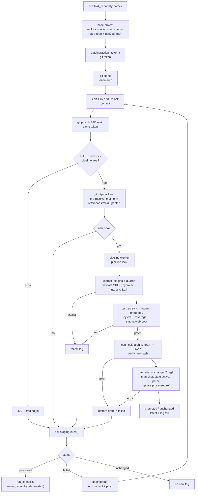
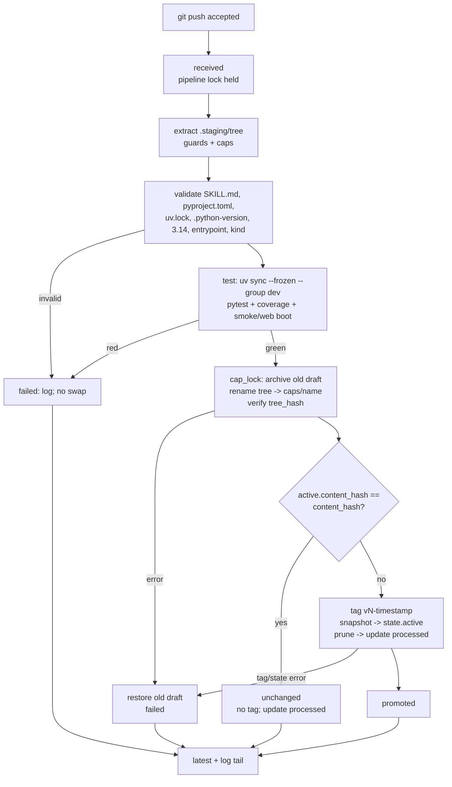

# capforge — git-authored capabilities (scaffold → clone → push)

> Implementation note (0.6.0): the per-repo quota and the `CAPFORGE_MAX_PIPELINES`,
> `CAPFORGE_MAX_PUSHES` and `CAPFORGE_MAX_CLONES` concurrency caps described below were never
> implemented and are not current configuration. See [`docs/NEXT.md`](../docs/NEXT.md).

Status: primary authoring transport after removing the shared caps directory. This supersedes the
earlier receive-only draft: the model no longer edits the server's draft through a shared filesystem.
`scaffold_capability` publishes a real git repository containing the base project; the model clones
or downloads it, edits its own copy, and pushes. Capforge materialises the push, tests it, and
promotes on green.

Prerequisites, landing as separate changes:

1. **No shared caps directory.** `CAPFORGE_CAPS_DIR` becomes server-owned and is no longer the
   terminal's skills home. The terminal/model gets a repository, not a mount. `ensure_workspace_skill`,
   `CAPFORGE_GUIDE` and the per-turn folder manifest are retired; discovery moves to
   `list_capabilities`/`get_capability` and the `AGENTS.md` shipped inside the repository.
2. **URL namespaces and `CAPFORGE_PUBLIC_URL`** (§3): `/ui`, `/api`, `/git`, `/cap`.
3. **Python 3.14 + uv runtime** (§9): every capability is a uv project with `pyproject.toml`,
   `uv.lock` and `.python-version`; the server builds state-owned venvs with `uv sync --frozen`.
4. **`core.track_child()` / `core.untrack_child()`**: `sweep_stray_children()` kills every direct
   child not registered as live/owned; git CGI, `git archive` and the uv children must register.
5. **Token/staging state** (`staging.py`): git token minting, staging state and `latest`.
   The archive/bundle upload plans are no longer prerequisites; they become optional import paths.

The git repository makes these older steps unnecessary. They are removed in this change, not kept as
parallel paths:

| Removed step/tool | Why it is unnecessary |
|---|---|
| `install_packages` | Dependencies live in the pushed `pyproject.toml` and `uv.lock`; `uv sync --frozen` is the only install path. |
| `test_capability` | The pipeline tests the pushed tree before promotion. Local iteration uses `uv sync`/`pytest` in the clone; operators can use `capforge test` for recovery. |
| `promote_capability` | The git worker is the only promotion caller; operators can use `capforge promote` for recovery. |
| `packages` frontmatter / `requirements_hash` | New capabilities use the uv project; the old fields are removed, and old state is refused with a migration error. |
| caps-root git audit | The capability repo is the code history; state plus `refs/capforge/processed` record promotions. No second repository. |
| per-turn `_capforge` guide / shared manifest | Removed with the shared dir; the guide lives in the scaffolded repo and `get_contract`. |
| manual base promotion | The base is a template; the first push promotes. `run_capability` can still run the scaffolded base draft. |

The model-facing MCP surface becomes ten tools: `get_contract`, `list_capabilities`,
`get_capability`, `scaffold_capability`, `run_capability`, `serve_capability`, `staging`,
`delete_capability`, `rollback_capability`, `list_tags`. This is one deliberate cache-breaking release (add `staging`,
remove `install_packages`, `test_capability`, `promote_capability`).

Quality gates: add `pytest-cov` as a **dev-only** dependency, a `[tool.coverage.*]` configuration,
and a CI/DoD coverage floor taken from the measured baseline and ratcheted upward. Diagnostics are
exposed through existing action-based tools, not a new MCP tool (§8.2).

## 1. Authoring loop

```
scaffold_capability(name)                         # base project + bare repo + initial commit
  → staging(name, action="token")
  → git clone <CAPFORGE_PUBLIC_URL>/git/<name>.git     # model's own workspace
  → edit, uv add/uv lock as needed, commit
  → git push origin HEAD:main
  → staging(name, action="latest")                # received → … → promoted | failed
```

The server's `<caps>/<name>` is a **derived draft**: the last accepted push (or the scaffold's base
commit), materialised for testing and the first-run fallback. It is not the model's editing surface.
A failed push leaves the previous draft and active tag untouched; the push is still in the repo's
history, so the model fixes it with another commit.

### 1.1 End-to-end process



Logs: `staging(action="latest")` returns the state plus `log_tail`; `staging(action="logs",
kind="pipeline"|"scaffold")` returns the full tail; `serve_capability(action="logs")` returns the
served child log. The pipeline log carries the capability’s coverage table; capforge’s own coverage
floor is the CI/DoD gate. There is no MCP promote tool; operator recovery is `capforge promote` or
`capforge test` on the CLI.

## 2. Locked decisions

- **Shared filesystem:** removed. No mount is shared with Open Terminal. The model sees capability
  code only through its own git repo or the explicit `get_capability` MCP read; it cannot reach
  `state`, venvs, tokens or other capabilities through a filesystem mount.
- **Scaffold:** creates a bare repo at `<state>/git/<name>.git` with an initial `main` commit
  containing the base project, and materialises that commit into `<caps>/<name>`.
- **Transport:** both `upload-pack` (clone/fetch) and `receive-pack` (push), authenticated. No
  anonymous clone, no dumb HTTP, no `git://`. The model downloads the base project by cloning.
- **Refs:** only `refs/heads/main`. Deletes and non-fast-forwards are refused. Clone/fetch is
  available, so the guide uses `git pull --rebase` before pushing; force is not needed.
- **Auth:** short-lived git tokens, bound to one capability; TTL 600 s, multi-request, hashed at
  rest, request/byte/attempt caps. One token grants both clone and push; there is no scope
  parameter.
- **Actor identity:** captured at mint from the Open WebUI headers; `pushed_by` comes from the token,
  never from push headers. The Basic username must equal `actor_id` when present
  (`CAPFORGE_GIT_CHECK_USER=1`). Attribution only; the trusted perimeter still matters.
- **Python:** fixed at 3.14. Every capability declares `requires-python = ">=3.14,<3.15"`, pins
  `.python-version` to `3.14`, and commits `uv.lock`.
- **Venvs:** built by `uv sync --frozen` into `<state>/venvs/...`, never inside the draft. Production
  uses `--no-dev`; tests use the `dev` dependency group (pytest). `SKILL.md` no longer carries a
  `packages` field.
- **Data:** runtime files go only under `CAPFORGE_DATA_DIR` (per-version). `data: shared` opts into a
  stable `CAPFORGE_SHARED_DATA_DIR`; code trees are not writable, and data is never committed.
- **Filesystem confinement:** capability children (CLI, pytest, web) and git/uv children run under a
  Landlock allowlist: system/venv/own-code read, own data dirs read/write, everything else denied.
  `CAPFORGE_SANDBOX` defaults to `require`; network is still unconfined (seccomp/cgroups later).
- **No application kill switch:** authoring is enabled whenever the `:8080` listener is enabled.
  Operators disable it by stopping the listener or blocking `/git` at the proxy. TLS in front of
  `:8080` is mandatory.
- **Pipeline:** transactional. The pushed tree is tested in an immutable staging directory; the
  server draft is swapped and promoted only on green.
- **Async:** `git push` returning `0` means “received”, not “promoted”; the model polls `latest`.
- **Tool surface:** ten tools. Promotion and testing are pipeline-only; `install_packages`,
  `test_capability` and `promote_capability` are removed. Operator recovery uses `capforge promote`
  and `capforge test` on the CLI, not the model-facing surface.
- **Logs:** per-capability bounded logs are exposed through existing actions
  (`staging(action="logs")`, `serve_capability(action="logs")`); no tenth tool.

## 3. URL namespaces and `CAPFORGE_PUBLIC_URL`

### 3.1 Listener layout

| Path | Purpose |
|---|---|
| `/ui/` | Console SPA (static, public; `CAPFORGE_WEB_UI=0` disables) |
| `/api/...` | Console/control API (session + CSRF; can be disabled) |
| `/git/<name>.git/info/refs?service=git-upload-pack` | Clone/fetch advertisement |
| `/git/<name>.git/git-upload-pack` | Clone/fetch data |
| `/git/<name>.git/info/refs?service=git-receive-pack` | Push advertisement |
| `/git/<name>.git/git-receive-pack` | Push |
| `/cap/<name>/` | Served capability reverse proxy |
| `/` | `308` to `/ui/`, or the JSON index when the UI is disabled |

Route order: `/api`, `/git`, `/ui`, `/cap`, `/`. There is no root `/{name}` catch-all, so a
capability named `git`, `ui`, `api` or `cap` is fine at `/cap/<name>/`. `_capforge` remains reserved.

The UI moves to `/ui/` (Vite `base: "/ui/"`), and its API calls resolve `/api` relative to
`document.baseURI` so a proxy prefix works. Absolute `/api` fetches only work at the origin root.

### 3.2 `CAPFORGE_PUBLIC_URL`

`CAPFORGE_PUBLIC_URL` is the server's externally reachable base, including any proxy prefix:

```
CAPFORGE_PUBLIC_URL=https://caps.example.com
CAPFORGE_PUBLIC_URL=https://example.com/capforge
git_url  = <CAPFORGE_PUBLIC_URL>/git/<name>.git
cap_url  = <CAPFORGE_PUBLIC_URL>/cap/<name>/
ui_url   = <CAPFORGE_PUBLIC_URL>/ui/
```

- `public_base()` reads it, strips trailing `/`, validates `http`/`https`; if unset, derives
  `http://<display-host>:<web-port>` for local development. Production deployments should set it,
  especially behind a proxy or TLS terminator.
- Never derive the git URL from the MCP listener. `scaffold_capability` and `staging(token)` run on
  `:8099`, while the repo is on `:8080`.
- The server process treats `CAPFORGE_PUBLIC_URL` as the base. A served child receives its own full
  capability URL (`<base>/cap/<name>/`) under the same variable name, matching the existing child
  contract; never pass the base to a child.
- If the base carries a path prefix, the proxy must strip it before forwarding; otherwise capforge
  sees `/capforge/api` and every route breaks. Document this in the deployment section.
- `doctor` validates the URL, warns when the scheme is `http`, and prints one example clone/cap URL.

### 3.3 Environment changes

| Variable | Default | Meaning |
|---|---|---|
| `CAPFORGE_PUBLIC_URL` | derived | Server public base; children receive their full cap URL under the same name |
| `CAPFORGE_REQUIRE_USER` | `0` | Refuse minting without an actor |
| `CAPFORGE_GIT_CHECK_USER` | `1` | Require Basic username == token actor id |
| `CAPFORGE_GIT_TOKEN_TTL` | `600` | Git token lifetime, seconds |
| `CAPFORGE_GIT_TIMEOUT` | `300` | CGI/pack transfer wall-clock budget |
| `CAPFORGE_REPO_QUOTA_BYTES` | e.g. 512 MiB | Per-repo on-disk quota |
| `CAPFORGE_MAX_PIPELINES` | `2` | Global concurrent pipelines |
| `CAPFORGE_MAX_PUSHES` | `4` | Global in-flight push/spool cap |
| `CAPFORGE_MAX_CLONES` | `4` | Global concurrent clone transfers |
| `CAPFORGE_LOG_MAX_BYTES` | `1 MiB` | Per-capability log rotation size |
| `CAPFORGE_LOG_TAIL_BYTES` | `64 KiB` | Default/capped tail received over MCP |
| `CAPFORGE_SANDBOX` | `require` | `require` / `warn` / `off` Landlock policy for children |
| `CAPFORGE_INSTALL_TIMEOUT` | existing | `uv lock` / `uv sync` budget |

Every limit belongs in `get_contract()`, the README table, `doctor` and the tests.

## 4. Scaffolding: the base project and initial commit

`scaffold_capability(name, description, kind)` builds a self-contained uv project in a temp dir, locks
it, commits it, and publishes it as `main` in the bare repo. Nothing is half-created: a failure rolls
back the temp project and reports the error.

```
<name>/
    AGENTS.md            # how to work in this repo and push; the contract in miniature
    SKILL.md             # name, description, entrypoint/app, kind, optional data: shared
    pyproject.toml       # requires-python = ">=3.14,<3.15"; deps; dev group; tool.uv
    uv.lock              # generated by `uv lock`, committed
    .python-version      # 3.14
    main.py              # kind: cli; JSON stdin/stdout
    app.py               # kind: web; FastAPI app
    tests/              (the scaffold writes tests/test_scaffold.py)
    .gitignore           # .venv/, __pycache__/, .pytest_cache/, ...
```

CLI `pyproject.toml`:

```toml
[project]
name = "<name>"
version = "0.1.0"
requires-python = ">=3.14,<3.15"
dependencies = []

[dependency-groups]
dev = ["pytest", "pytest-cov"]

[tool.uv]
package = false

[tool.coverage.run]
source = ["."]
omit = ["tests/*"]

[tool.pytest.ini_options]
addopts = "--cov=. --cov-report=term-missing"
```

`kind: web` adds `fastapi`, `uvicorn` and `httpx` to `dependencies` (the scaffold test drives the ASGI
app through `httpx.ASGITransport`). The server uses `uv init --bare`/an equivalent template, then
`uv add`/`uv lock` with the install environment; `uv` generates `uv.lock`, which is committed with the
project.

Scaffold steps:

1. Validate the name/kind/description.
2. Build the temp project and run `uv lock` (`CAPFORGE_INSTALL_TIMEOUT`, install env, temp
   `HOME`/`XDG_CONFIG_HOME`, no secrets in the capability env).
3. `git init`, add, commit with a capforge identity.
4. Create `<state>/git/<name>.git` if absent, publish the commit as `refs/heads/main`, set `HEAD` to
   it. If the capability or repository already exists, refuse; there is no scaffold overwrite mode.
5. Materialise the initial commit into `<caps>/<name>` through the same archive/guard path used by
   pushes, so the first-run draft and the repo content are identical.
6. Return `{name, git_url, kind, python: "3.14"}`. The model then calls
   `staging(name, action="token")` for clone/push credentials.

No tag is created by scaffold: the materialised base is the draft and the first-run fallback until
the first push is tested and promoted. `run_capability` therefore behaves as it does today for a
capability that has never been promoted.

Scaffolding no longer installs packages into a venv; the first test/run/push builds the uv
environment from the committed lock. The base project is visible in `list_capabilities` and
`get_capability` as the draft, and in the model's clone as ordinary files. Runtime state defaults to
the per-version `CAPFORGE_DATA_DIR`; adding `data: shared` to `SKILL.md` opts into the stable
`CAPFORGE_SHARED_DATA_DIR`.

**Discovery without the shared dir.** The model no longer sees capability folders in its per-turn
manifest. `get_contract` explains the clone/push loop, `list_capabilities` is the index, and
`get_capability` returns the last materialised draft. The repo's `AGENTS.md` carries the same guidance
for the model's local workspace.

## 5. Git routes and CGI bridge

```
GET  /git/{name}.git/info/refs?service=git-upload-pack
POST /git/{name}.git/git-upload-pack
GET  /git/{name}.git/info/refs?service=git-receive-pack
POST /git/{name}.git/git-receive-pack
```

1. Validate `{name}` with `NAME_RE`; reject any other `/git/` shape. Accept only the two services;
   reject `HEAD`/`OPTIONS`, dumb HTTP and unknown content types.
2. Authenticate before reading the body (§6). On success set `REMOTE_USER` from the token's actor,
   never the Basic username. Do not spawn on failure.
3. For `receive-pack`, take the per-name **push lock** non-blockingly; return `409` with the running
   `staging_id` if a pipeline owns the capability, `503` if the global upload cap is full. `upload-pack`
   is read-only and does not take the push lock; it is bounded by `CAPFORGE_MAX_CLONES`.
4. Spool the request body (`receive-pack` wants/haves are small; `upload-pack` negotiation is small
   too) with `CAPFORGE_MAX_UPLOAD_BYTES` and a read deadline. Never stream a request body directly
   into the CGI child.
5. Spawn `git http-backend` in a new process group, registered with `core.track_child()`, in a
   threadpool (`run_in_threadpool`/`anyio.to_thread`). Wrap it in `prlimit` when available
   (`RLIMIT_AS`, `RLIMIT_CPU`, `RLIMIT_FSIZE`, `RLIMIT_NOFILE`) and enforce `CAPFORGE_GIT_TIMEOUT`
   with a group kill. Environment: allowlist plus `GIT_PROJECT_ROOT=<state>/git`,
   `GIT_HTTP_EXPORT_ALL=1`, `PATH_INFO` **built from the validated name and service**,
   `QUERY_STRING`, `REQUEST_METHOD`, `CONTENT_TYPE`, `CONTENT_LENGTH=<spooled bytes>`, `REMOTE_USER`,
   `REMOTE_ADDR`, `GIT_PROTOCOL`, `GIT_CONFIG_NOSYSTEM=1`, `GIT_CONFIG_GLOBAL=/dev/null`, empty
   `GIT_TEMPLATE_DIR`, temp `HOME`/`TMPDIR`, explicit `GIT_EXEC_PATH`/`PATH`, and a low
   `http.maxRequestBuffer` / `GIT_HTTP_MAX_REQUEST_BUFFER`.
6. Parse the CGI headers (`Status:`, default `200`; allow only `Content-Type`, `Content-Length`,
   `Cache-Control`, `Expires`, `Pragma`; strip hop-by-hop headers).
   - `info/refs` and `receive-pack` reports are bounded and buffered (1 MB is enough for one ref).
   - `git-upload-pack` can return a packfile of repo size: **stream** it to the client with a
     `StreamingResponse` (or a temp-file-backed response), keeping stderr drained and killing the
     child on client disconnect. Do not buffer a clone.
7. For `receive-pack`, record the old sha before spawning and the new sha after a successful response
   (`git rev-parse refs/heads/main`); a changed, non-empty sha that differs from the processed sha
   triggers the pipeline. Do **not** parse the report body: it is pkt-line/sideband and HTTP `200` is
   returned even when git rejects the ref with `ng`.
   `upload-pack` never triggers a pipeline and never takes the push/pipeline locks.

Failure mapping: auth `401` before spawn; busy `409`; capacity `503`; body too large `413`; quota
`507`; backend failure `502` with a generic message. Git's stderr never reaches the client; hook
messages travel in git's report.

## 6. Auth, tokens and attribution

- Token format `cfg_<id>.<secret>`; look up by `id`, compare
  `hmac.compare_digest(sha256(secret), record["secret_hash"])`. Never store or log the plaintext.
- Record fields: `name`, actor fields, `created_at`, `expires_at`, `requests`, `bytes`, `last_used`,
  `revoked`. A token grants both clone and push for its capability; there is no scope field or
  `scope` argument.
- HTTP Basic (username must equal the token actor id, token as password). `401` carries
  `WWW-Authenticate: Basic realm="capforge/<name>"`; use `401` for unknown/expired tokens and
  unknown names so the token space is not enumerable.
- Validate at request start; an in-flight transfer is not interrupted by expiry. TTL
  `CAPFORGE_GIT_TOKEN_TTL` (default 600). Bound live tokens per name and globally; prune expired
  records on mint/startup; cap mint rate per name/actor.
- Cap requests and bytes per token. Rate-limit failed auth by IP and token id (separate from the
  console backoff); return `429` with `Retry-After`.
- Basic username must equal `actor_id` when the token has an actor and
  `CAPFORGE_GIT_CHECK_USER=1`; an empty username is `401`.
- `pushed_by` is the token's `actor_id`, with `actor_role` and `actor_source`. Store `chat_id` /
  `message_id` when present. Truncate and strip control characters.
- `CAPFORGE_REQUIRE_USER` defaults to `0`; when `1`, minting without an actor fails. Headers are
  spoofable by anyone with the MCP credential; attribution only.
- Clone credentials: use a credential helper or `GIT_CONFIG_*`/`http.extraHeader`; never document
  token-in-URL, which leaks into `.git/config`, process listings and shell history. `git clone` with
  a git token is the download mechanism.
- Never log `Authorization`, the token, its hash or Basic credentials. The token appears only in the
  mint response.

## 7. Repository configuration and lifecycle

Created by scaffold under the capability lock, idempotently, with `git init --bare`, `HEAD` set to
`refs/heads/main`, and sanitized git config:

```
receive.denyDeletes          true
receive.denyNonFastForwards  true
receive.fsckObjects          true
receive.maxInputSize         <CAPFORGE_MAX_UPLOAD_BYTES>
core.logAllRefUpdates        true
gc.auto                      0
http.receivepack             true
http.uploadpack              true
```

The managed `pre-receive` hook is static and written atomically (mode `0755`) with a marker so a
future capforge can upgrade an unmodified hook:

```sh
#!/bin/sh
[ -n "$CAPFORGE_PIPELINE_LOCK" ] || exit 1
while read -r old new ref; do
  [ "$ref" = "refs/heads/main" ] || { echo "only refs/heads/main is accepted"; exit 1; }
done
flock -n "$CAPFORGE_PIPELINE_LOCK" true || { echo "a pipeline is already running"; exit 1; }
exit 0
```

The hook checks the **pipeline** lock, never the push lock the route holds. It is a backstop for a
non-HTTP local push; the route is authoritative for HTTP. `upload-pack` does not invoke it.

`gc.auto=0`; after a successful promotion the worker runs `git gc --quiet` with a timeout while still
holding the pipeline lock (best effort; never fails the promotion). Clean `objects/pack/tmp_*` on
failure and at startup.

Repos are kept when a capability is pruned or deleted; `doctor` lists orphans and their sizes.
Quota: require `current_size + CAPFORGE_MAX_UPLOAD_BYTES <= CAPFORGE_REPO_QUOTA_BYTES` before accepting
a push, otherwise `507`. Cache the size calculation; do not `du` on every `latest` poll.

## 8. Materialisation, pipeline and durability

1. **Received.** Write the staging state (sha, actor, `git_source`, heartbeat) atomically. The
   pipeline lock is held by the worker before the push lock is released.
2. **Extracting.** `git archive refs/heads/main` → `tarfile` (`r|`, `filter="data"`) into
   `<caps>/.staging/<name>-<id>/tree/`. Spawn `git archive` as a registered child; drain stderr;
   check its exit; kill its group on the extraction cap. Guards: reject symlinks, hardlinks, devices,
   FIFOs, absolute/`..` paths, `.git`, `.venv`, `__pycache__`; cap bytes, members, path length and
   file count. Post-extract walk rejects links.
3. **Validating.** If `SKILL.md` is absent, copy the current draft's `SKILL.md` (record
   `inherited_skill`); force `name` to the capability name. Validate frontmatter (no `packages`
   field; optional `data: version|shared`), `pyproject.toml`, `uv.lock`, `.python-version`, the
   entrypoint containment and `kind`; a web kind gets the boot probe. Validate the uv project (§9).
4. **Testing.** Run the shared test pipeline against the staging tree, not the live draft:
   `load_capability_at(name, tree)`, `uv sync --frozen` into the test venv, pytest from the dev group,
   then a prod smoke run (or web boot) as the existing gate does. A red result records `failed` with
   truncated output and leaves the draft/active untouched.
5. **Swapping and promoting (one `cap_lock`).** On green, take `cap_lock(name)` and keep it
   through the snapshot and state write: verify the tested hash, archive the old draft with
   `os.rename` to `<caps>/.staging/backups/<name>-<timestamp>`, `os.rename(tree, <caps>/<name>)`,
   snapshot, update state/prune, and write. If any step fails, restore the archived draft before
   releasing and report `failed`. **Never `os.replace` the directory** (rename onto a non-empty
   directory fails with `ENOTEMPTY`), and **never take `cap_lock` again inside the promote path**
   (nested flock deadlocks). The worker calls a locked/source variant of the promote
   implementation; the operator `capforge promote` CLI acquires the lock once.
6. **Recording and retention.** Write the snapshot metadata (`env: "uv"`, `lock_hash`,
   `python: "3.14"`, `git_source`, `pushed_by`, note, `promoted_at`, `previous`), set `active`,
   append the tag, prune, and write state atomically inside that same `cap_lock`. After the state
   write, update `refs/capforge/processed`; a failed update is repaired at startup from the active
   tag’s `git_source.sha`. The capability repo is the history; there is no caps-root audit repo.
7. **Unchanged.** If the tested tree equals the active content hash, record `unchanged` and do not
   create a tag (`versioning.promote` refuses an unchanged draft; handle that result; the pipeline
   never forces).
8. **Crash recovery.** On startup, any non-terminal state with a stale heartbeat becomes
   `interrupted`; compare each repo's `refs/heads/main` with `refs/capforge/processed` and enqueue or
   mark `interrupted`. Clean stale `.staging` dirs. A crash cannot silently drop a push or leave a
   capability permanently locked.
9. **State machine:** `received → extracting → validating → testing → promoted | unchanged | failed |
   interrupted`, with a heartbeat (write every 5 s; stale after 30 s).
10. **Serving.** A promotion does not restart a `kind: web` instance; `latest` reports the stale tag
    and the model calls `serve_capability(action="restart")`.

### 8.1 Promotion semantics

Promotion is the only draft → runnable transition. Its normal caller is the git worker, after the
staged tree has tested green and been swapped into the draft. The only other entry point is the
operator `capforge promote` CLI for recovery; there is no MCP promote tool.

The worker already holds `cap_lock` for the draft swap, so it calls a `promote_locked`/`source=`
variant that does not acquire the lock again. Reacquiring would deadlock.



1. Load the draft and re-check `draft_ready`: `SKILL.md` and description, contained entrypoint,
   `pyproject.toml`, `uv.lock`, `.python-version` and the 3.14 pin. Reject a `packages` field; the
   field is removed.
2. Compute `content_hash = tree_hash(draft)` and `lock_hash = sha256(uv.lock)[:16]`.
3. Under `cap_lock(name)`:
   - Read state. If `active.content_hash == content_hash`, return `promoted: false` with reason
     “identical to the active version”. The git worker maps this to `unchanged`, advances
     `refs/capforge/processed` to the pushed sha, and creates no tag.
   - Choose the tag `v<n>-<timestamp>`; refuse if it already exists. Tags are immutable.
   - Snapshot the draft to `versions/<name>/<tag>/` (copy with `SKIP`; a venv is never in the draft).
   - Record `env: "uv"`, `lock_hash`, `python: "3.14"`, `entrypoint`, `content_hash`,
     `git_source: {ref, sha, subject}` and `pushed_by` in the state/note, plus `promoted_at` and
     `previous`.
   - Replace/append the tag, set `active` to the snapshot, and prune old tags: keep
     `CAPFORGE_KEEP_TAGS`, never the active tag, stop a web instance pinned to a pruned tag, and
     remove that tag’s data and unused venvs.
   - Write state atomically; then update `refs/capforge/processed` in the capability repo.
4. Return the tag, hashes, `env`, `previous`, `pruned` and `version_path`; log
   `promote cap=… tag=… previous=… pruned=…`.

What promotion does **not** do: it does not copy files from the model’s clone (the source is the
materialised draft), does not ship a venv, does not rebuild an existing prod venv for the same
`lock_hash`, does not restart a served instance, and does not overwrite an existing tag.

Failure handling:

- **Red tests:** no swap, no snapshot, no promotion; state `failed`; the previous draft and active
  tag are untouched.
- **Promotion failure after a green swap** (tag collision, disk full, state write): restore the
  archived old draft from `.staging/backups/...` and report `failed`; the pushed commit remains in
  the repo for a retry. If the restore also fails, log it and leave the new draft with `failed`.
- **Legacy tags:** the pip path is removed in this release (0.4.0). Tags with
  `packages`/`requirements_hash` are not runnable; state lacking `lock_hash` returns a migration
  error. The migration note tells operators to re-promote with `pyproject.toml`/`uv.lock` before
  upgrading; after upgrading, restore the old version’s code, add the uv project, and push. New tags
  are `env: "uv"`; there is no `packages` argument.

The capability repo is the code history. State plus `refs/capforge/processed` are the promotion
record; there is no caps-root audit repository.

The pipeline is the only test and promotion gate. Local iteration uses `uv sync`/`pytest` in the
clone; `capforge test` is the operator recovery path. There is no MCP test or promote tool.

`git archive` honours `.gitattributes` in the pushed tree (`export-ignore`, `export-subst`); the
materialised tree can differ from the sha. Validation must catch a hidden `SKILL.md`/entrypoint.
Gitlinks are not materialised; LFS pointers stay pointers; `--recurse-submodules` is not used.

### 8.2 Logs the model can see

The model has no shared filesystem, so diagnostics must come back through MCP. Add a bounded,
per-capability log store, but do not add a tool:

```
<state>/logs/<name>/scaffold.log     # base project, uv lock, initial commit
<state>/logs/<name>/pipeline.log     # last push: stages, test output, promotion result
<state>/served/<name>/<tag>/server.log   # existing served-child log
```

- `scaffold_capability` writes `scaffold.log` (and returns the `uv lock` tail on failure).
- The git worker writes `pipeline.log` with `staging_id`, each state transition, pytest
  stdout/stderr tails (including the capability’s coverage table when its `pyproject.toml` enables
  coverage), promotion tag/result, and the failure reason.
- `staging(name, action="latest")` includes `log_tail` (last
  `CAPFORGE_LOG_TAIL_BYTES`), `log_bytes`, `log_truncated` and `staging_id`.
- `staging(name, action="logs", kind="pipeline"|"scaffold", tail=...)` returns the log tail. `tail` is
  clamped to `CAPFORGE_LOG_TAIL_BYTES`; return text and metadata, never the log file’s filesystem
  path (the content may contain paths from capability output).
- `serve_capability(action="logs", tail=...)` returns the served child’s `server.log` tail (reuse
  the existing `_log_tail`); `status` includes a short tail when the child failed.
- `run_capability` already returns stdout/stderr tails; optionally persist the same tail to a
  per-run log, but do not replace the inline result.
- Rotate each log at `CAPFORGE_LOG_MAX_BYTES` (one generation), so a runaway test cannot fill the
  disk. `doctor` reports log sizes.
- Redact `Authorization`, git/console tokens, index credentials and `*_KEY=…` values before writing.
  Never write the capability environment. Capability stdout/stderr may be shown to the model; that
  is its own output.
- The console can expose the same tails at `/api/caps/<name>/logs` later; the MCP actions are the
  contract and keep the surface at ten tools.

## 9. Python 3.14 and uv environments

Every capability is a uv project. The server never runs `pip install`, never reads a `packages`
frontmatter field, and never installs into the draft.

- **Interpreter:** fixed at 3.14. The image ships Python 3.14 and uv; `UV_PYTHON=3.14` and
  `UV_PYTHON_DOWNLOADS=never` make uv use it. The venv's `python -c "import sys"` is checked to be
  3.14 before a run. `requires-python` must include 3.14 and exclude 3.15
  (`>=3.14,<3.15`); `uv sync --frozen --python 3.14` fails loudly if the project forbids it.
- **Source of truth:** the pushed `pyproject.toml` + `uv.lock` + `.python-version`. `uv sync
  --frozen` fails if the lock is missing or drifts from the project; the pipeline refuses before
  tests. `uv lock --check` is part of validation.
- **Prod venv:** `<state>/venvs/<name>/<lock_hash>-py314/`, built with
  `UV_PROJECT_ENVIRONMENT=<venv> uv sync --frozen --no-dev --no-install-project --python 3.14`,
  cwd = the draft or tag. `run_capability` and served web children use it.
- **Test venv:** `<state>/venvs/<name>/<lock_hash>-py314-test/`, built with
  `UV_PROJECT_ENVIRONMENT=<venv> uv sync --frozen --group dev --no-install-project --python 3.14`.
  The `dev` group includes `pytest` and `pytest-cov`; if either is missing, the pipeline fails with a
  clear message. pytest runs from this venv; the prod venv contains neither. The scaffold sets
  coverage over `.` (omitting `tests/`) so the pipeline log carries the coverage table; the model
  may add `--cov-fail-under=N` to its own `pyproject.toml` to make its tests fail below a threshold.
  Capability coverage is diagnostic, not a server-side gate.
- **Key:** `lock_hash = sha256(uv.lock bytes)[:16]`, plus the Python tag and group in the path. A
  lock change builds a fresh venv and makes `tree_hash` report a changed draft. Venv GC removes
  hashes no surviving tag/served instance needs.
- **Install environment:** `_install_env()` only. Add uv index settings (`UV_DEFAULT_INDEX`/
  `UV_INDEX_URL` and index credentials) alongside the existing pip settings; never expose them to
  capability code. Use a temp `HOME`/`XDG_CONFIG_HOME`, `UV_CACHE_DIR=<state>/cache/uv`,
  `UV_LINK_MODE=copy`, and the existing `CAPFORGE_INSTALL_TIMEOUT`. Run uv in its own process group
  and register it with `track_child()`.
- **Validation:** reject `[build-system]` and `[tool.uv] package = true` (a capability is not a
  package); reject `[tool.uv.sources]` with git/url/path entries and custom `[[tool.uv.index]]`
  entries (deps must come from the server-configured index); reject lock entries whose source is not
  a registry. This is a supply-chain boundary: `uv sync` executes build backends from sdists just as
  pip did, so keep sources restricted and prefer wheels/`--no-build` where the dependency set allows.
- **Legacy tags:** no pip runner. Tags with `packages`/`requirements_hash` are refused with a
  migration error; new tags are `env: "uv"`. This is a 0.4.0 breaking change.
- **No model-facing install/test/promote:** dependencies are edited in the clone (`uv add` / `uv lock`), tests run locally or in the pipeline, and promotion is the pipeline. `install_packages`, `test_capability` and `promote_capability` are removed from the MCP surface; `capforge` CLI commands cover operator recovery.
- **`uv` version:** pin a minimum (the image's uv) and report it in `doctor`, together with
  `python3.14`, `git`, `git-http-backend`, the cache, and the venv root. CI caches the uv cache.

### 9.1 Capability data and files

Code lives in the repo; runtime data lives outside it and is never committed or pushed.

- `CAPFORGE_DATA_DIR` is always `<state>/data/<name>/<tag>/` (or `draft` / `test` for those runs). It
  is writable, per-version and removed when that tag is pruned. A new tag starts empty; older tags
  keep their data until prune.
- The version/draft tree is code, not a data store. A capability must not write beside `main.py`:
  the tag is an immutable snapshot and the draft is derived, so writes there are lost or rejected.
- For state that must survive pushes, opt in with `data: shared` in `SKILL.md`:
  - `CAPFORGE_SHARED_DATA_DIR=<state>/data/<name>/shared/` is created on first use, stable across
    tags, never removed by prune and never snapshotted.
  - Shared data breaks the “same args + same data = same result” assumption. The capability owns
    schema migrations, concurrent-writer safety (a CLI call and a served web child can overlap) and
    backups. The operator backs up `<state>/data/<name>/shared/`; `doctor` reports sizes.
- Test runs use `<state>/data/<name>/test/`; test data is scratch and is never promoted. Served web
  children use their tag’s data dir (or shared) and must not write into their cwd.
- Model access to files:
  - CLI capabilities return file content or a URL in their JSON result (bounded); `run_capability`
    does not expose arbitrary files.
  - Web capabilities serve downloads through their own routes, proxied under `/cap/<name>/...`.
  - If the model needs a generic read, add a `get_capability(action="data", path=..., tail=...)`
    action: contained to that capability’s data dirs, read-only, size-capped, no symlinks. It remains
    an action on an existing tool, not a tenth tool.
- Data is not in git, not in `versions/`, and not in `tree_hash`; a push never changes it. Committed
  fixtures or templates belong in the repo and are read-only at runtime.

## 10. Concurrency and locking

Three locks, always acquired in this order:

1. **push lock** — `<state>/locks/<name>-git-push.lock`, held by the receive-pack route across the
   CGI request. Serialises HTTP pushes per name; non-blocking acquisition returns `409`. `upload-pack`
   does not take it.
2. **pipeline lock** — `<state>/locks/<name>-pipeline.lock`, held by the async worker for the whole
   pipeline. The route checks it before accepting (clean `409` with the running `staging_id`); the
   `pre-receive` hook checks it as a backstop. The route must **not** hold it while the CGI child runs,
   or every push hook would fail.
3. **cap lock** — existing `core.cap_lock(name)`, taken by the worker only after the pipeline lock.
   Never `cap_lock` → pipeline.

The draft swap and the promotion (snapshot, state, prune) are **one `cap_lock` critical section**.
Do not hold `cap_lock` and call a promote function that acquires it again; use the locked/source
variant. This is the nested-flock deadlock the repository rules warn about.

Handoff: after the CGI succeeds, while still holding the push lock, the route starts the worker and
waits (bounded) until the worker owns the pipeline lock, then releases the push lock. A worker that
cannot start marks `failed`, releases the push lock and returns `500`. There is no window in which a
second push passes the check.

A push while a pipeline is non-terminal is refused; the model retries after `latest` is terminal.
Concurrent pushes to different capabilities are bounded by `CAPFORGE_MAX_PIPELINES` (default 2) and
`CAPFORGE_MAX_PUSHES` (default 4); clones are bounded by `CAPFORGE_MAX_CLONES` (default 4). Return
`503` with `Retry-After` when full. Do not hold a semaphore while blocked on a per-name lock.

`track_child()` covers the CGI child, `git archive`, `rev-parse`, `uv lock`/`uv sync`, pytest and the
worker's subprocesses. Served uvicorn children stay in the owned set. A concurrent
`run_capability` or CLI test must not sweep any of them.

## 11. Security and DoS

- **Removing the shared dir is a security improvement:** the model can no longer read or write
  `versions`, `state`, tokens, venvs or other capabilities through the terminal mount. Its only
  inputs are the MCP surface and an authenticated git repo. This is authoring isolation, not runtime
  isolation: pushed code still executes as the server user, and Landlock (§11.1) restricts its
  filesystem view. Network, CPU, memory and ptrace remain unconfined.
- **Read surface:** `upload-pack` exposes the capability's code to any git token holder. It does not
  expose state; keep repos free of secrets. Scope enforcement and TTL matter. No anonymous clone.
- **Packfiles** reach git's C parser. Receive-only would be smaller, but clone is required for
  authoring. Keep git current; `fsckObjects`, `maxInputSize`, `prlimit`, timeout + group kill,
  allowlisted env, no system/global git config, temp `HOME`/`TMPDIR`, generic `502`.
- **uv supply chain:** `uv sync` resolves and may build third-party packages. Restrict sources to the
  configured index; reject local/git/url sources and custom indexes; run with the install env (no
  capability secrets), a timeout and a process group. Prefer wheels; consider `--no-build`.
- **Python 3.14:** the server's interpreter is fixed; capability code cannot select another. A
  dependency that does not support 3.14 fails the pipeline with a clear uv error.
- **Tokens:** hashed at rest, per-capability, TTL-bound, request/byte-capped, never logged; Basic username
  binding; per-capability realm. TLS in front of `:8080` is mandatory; `doctor` warns on plain HTTP.
- **Token in a header only.** Credential helper or `GIT_CONFIG_*`; not in the URL.
- **Disk:** spool cap, extraction cap, repo quota, uv cache, venv GC, `git gc`, tmp cleanup at
  startup. Clone response streaming is bounded by the repo quota and the transfer timeout.
- **Path safety:** build `PATH_INFO` from the validated name and known service; reject encoded
  `..`/`/`, duplicate slashes, wrong methods/content types, `Content-Encoding`, and CORS preflights.
  Add `X-Content-Type-Options: nosniff` and `Cache-Control: no-store`.
- **Rate limits:** auth failures (IP and token id), mint rate, per-token requests/bytes, clone and
  push concurrency. Do not reuse the console lockout state.

### 11.1 Filesystem confinement (Landlock)

“Write only under `CAPFORGE_DATA_DIR`” is a contract rule, not a kernel boundary. To stop a
capability from reading state, tokens, other capabilities, the home directory or `/etc`, apply a
Landlock allowlist to every child:

- **Read + execute:** `/usr`, `/usr/local`, `/lib`, `/lib64`, `/bin` (and the `/bin` → `/usr/bin`
  symlink), the selected venv, the capability’s own code tree, `/etc/ld.so.cache`, `/etc/passwd`,
  `/etc/group`, `/etc/ssl/certs`, the configured `SSL_CERT_FILE`, and `/etc/localtime`.
- **Read + write:** the exact `CAPFORGE_DATA_DIR`; the exact `CAPFORGE_SHARED_DATA_DIR` when
  `data: shared`; a per-run `TMPDIR`/`HOME` under the data dir; `/dev/null` and `/dev/urandom`.
- **Denied:** `<state>` (including `state/`, `versions/`, `git/`, `logs/`, tokens), the rest of
  `<caps>` outside this capability’s own code, other venvs, other repos, `/proc`, `/sys`, `/tmp`,
  the user’s home, and every path not explicitly allowed.
- Allow the **exact** data directory, not `<state>/data/<name>`, so a capability cannot read the
  previous version’s data.
- Set `PR_SET_NO_NEW_PRIVS` before `landlock_restrict_self`; restrictions are inherited by
  subprocesses and cannot be dropped.
- Use a small helper (`capforge/sandbox.py` invoked as `python -m capforge.sandbox --policy ... --
  <cmd>`) rather than `preexec_fn` in the threaded server. The helper applies the rules and `execv`s
  the target; `close_fds=True` keeps state descriptors out of the child.
- Apply the same helper (with a different policy) to `execute`/pytest, served web children,
  `git http-backend` (repo + the exact pipeline lock read/write), `git archive` (repo read +
  staging write), and `uv sync` (project read, venv/cache/temp write, network, CA files; no state).
  Set `PYTHONDONTWRITEBYTECODE=1`, use a per-run `TMPDIR`, and run pytest with
  `-p no:cacheprovider` so it does not write into the code tree.
- `CAPFORGE_SANDBOX=require|warn|off` (default `require` for capabilities). If Landlock is
  unavailable and `require` is set, refuse to run with a clear error; `warn` logs and runs
  unrestricted during rollout. `doctor` reports the ABI and policy.
- Landlock is **filesystem-only**. It does not confine network, CPU, memory, ptrace or device
  access; add seccomp/cgroups, or use `bwrap`/`nsjail` for a full sandbox. Document this limit.
- `bwrap`/`nsjail` are alternatives if a full mount namespace is required; Landlock is preferred
  because it is unprivileged, per-process and works in the existing container without new
  capabilities.

| | Landlock | Bubblewrap (`bwrap`) |
|---|---|---|
| Mechanism | Linux LSM; per-process path allowlist | user/mount/PID/net/IPC/UTS namespaces + bind mounts; optional seccomp |
| Privileges | unprivileged with `no_new_privs` | unprivileged user namespaces, or a setuid install |
| Kernel | 5.13+; feature set by ABI | namespaces are old; user namespaces must be enabled |
| Filesystem | denies access outside allowed paths | **new mount namespace**; only explicitly bound paths exist |
| Path hiding | no; paths/metadata may remain visible | yes; `/state`, `/proc`, home can be absent |
| Network | ABI 4+ restricts TCP bind/connect only | full network namespace (`--unshare-net`) |
| PID/IPC/UTS/cgroup | no | yes |
| Seccomp | no | yes (`--seccomp`) |
| Resource limits | no | no; use cgroups separately |
| Dependencies | none (ctypes + helper) | `bubblewrap` binary |
| Container fit | good if the kernel supports it; no user namespaces needed | often blocked by container seccomp/AppArmor or disabled user namespaces |
| Overhead | low, in-kernel checks | namespace/mount setup per spawn |
| Failure mode | missing ABI or an omitted path → `EACCES` | user namespaces/mount setup denied |
| Best for | baseline FS confinement of semi-trusted capabilities | stronger isolation of untrusted code |

For capforge, **Landlock is the chosen mechanism for v1**. It is the proportionate baseline: it
stops a capability from reading state, tokens, other capabilities or the home directory, with no new
binary and no container changes. Bubblewrap/nsjail are out of scope unless capabilities become
untrusted or network/PID isolation becomes a requirement; the table above is retained as the
comparison for that future decision.

## 12. Code placement

| Piece | Where |
|---|---|
| `/ui`, `/api`, `/git`, `/cap` routes; `CAPFORGE_PUBLIC_URL`/`public_base()`; UI mount | `capforge/web.py`, `ui/vite.config.ts`, `ui/src/api.ts` |
| CGI bridge (both services), streaming clone, auth mapping, push trigger | `capforge/web.py` |
| Bare repo creation, initial commit publication, managed hook, archive, refs, gc/quota, reconciliation | new `capforge/gitremote.py` (stdlib + git binary) |
| Scaffold orchestration (base project, `uv lock`, commit), token minting, staging state | new `capforge/scaffold.py` and `capforge/staging.py` |
| uv project validation, lock hashing, uv venvs; no pip path | `capforge/core.py` |
| Landlock helper, policy construction, `CAPFORGE_SANDBOX`, ABI probe | new `capforge/sandbox.py`, `capforge/core.py`, `capforge/web.py`, `capforge/gitremote.py` |
| Runtime data dirs (`CAPFORGE_DATA_DIR`, `CAPFORGE_SHARED_DATA_DIR`), containment, test data | `capforge/core.py`, `capforge/web.py`, `capforge/contract.py` |
| Optional `get_capability(action="data")` read (contained, capped) | `capforge/server.py` |
| Bounded per-capability logs, rotation, redaction, `staging`/`serve` log actions | `capforge/core.py`, `capforge/staging.py`, `capforge/web.py`, `capforge/server.py` |
| Coverage gate (`pytest-cov`, `[tool.coverage.*]`), CI/DoD | `pyproject.toml`, `uv.lock`, `.github/workflows/deploy.yml`, `AGENTS.md` |
| Snapshot/promote state (`env`, `lock_hash`, `python`, `git_source`), locked/source promote, prune/GC | `capforge/versioning.py` |
| Base project templates (`pyproject.toml`, `AGENTS.md`, `SKILL.md`, entrypoints, tests) | `capforge/contract.py` |
| `staging(action="token")`, scaffold result, `get_contract`, ten-tool surface | `capforge/server.py` |
| Shared-dir removal, guide retirement, uv/git doctor checks, CLI `promote`/`test` recovery | `capforge/core.py`, `capforge/cli.py`, `capforge/contract.py` |
| Deployment, env and docs | `Dockerfile`, `docker-compose.yml`, `.env.example`, `README.md`, `docs/ARCHITECTURE.md`, `AGENTS.md`, `AGENTS.md.example` |
| Console base path and relative API calls | `ui/` |

`core.py`, `versioning.py`, `contract.py`, `staging.py`, `scaffold.py` and `gitremote.py` stay
stdlib-only (gitremote uses the git binary). `web.py` keeps starlette/httpx; `server.py` keeps
fastmcp. `versioning` imports `web` only lazily.

## 13. Implementation order

0. Prerequisites: remove the shared-dir assumption; `/ui` `/api` `/git` `/cap`; `CAPFORGE_PUBLIC_URL`;
   Python 3.14 + uv runtime (`uv sync`, pyproject/lock, state `lock_hash`); `core.track_child()`;
   token/staging state; **Landlock helper and policies** (`capforge/sandbox.py`, `CAPFORGE_SANDBOX`,
   ABI probe, denial tests). Each lands separately with tests.
1. `gitremote.py`: bare repo, initial commit publication, managed hook, refs, archive, gc/quota,
   reconciliation.
2. `scaffold.py` / `contract.py`: base project (uv), lock generation, initial commit; refuse an existing name.
3. `staging.py`: git tokens, TTL, actor binding, staging state, `latest`, bounded pipeline
   logs and the `logs` action.
4. `web.py`: both git routes, streaming clone, auth, push trigger, timeout/limits, child
   registration, served-child log tail.
5. `core.py` / `versioning.py`: uv environments, `SKILL.md` packages removal, state migration,
   snapshot/promote changes, log rotation/redaction, per-version and shared data dirs.
6. `server.py`: scaffold result, token, `get_contract`, log actions, optional `get_capability(data)`,
   ten-tool surface (remove `install_packages`, `test_capability`, `promote_capability`).
7. `cli.py`: `doctor` (uv, python 3.14, git/http-backend, repo root/quota, orphans, URLs) plus
   operator `promote`/`test` recovery commands.
8. UI and docs: `/ui` base, relative API, clone/push guide, shared-dir removal, deployment.
9. Tests and the coverage gate (`pytest-cov` dev-only, full suite, baseline floor).

## 14. Tests

Fast:

- Scaffold creates a uv base project (`pyproject.toml`, `uv.lock`, `.python-version`), an initial
  `main` commit, a materialised draft, and a clone URL; an existing name is refused.
- `requires-python` mismatch, missing `uv.lock`, lock drift, missing dev group/pytest, `[build-system]`,
  `package = true`, git/url/path sources and custom indexes are rejected with readable errors.
- Prod venv has no pytest; test venv does; both are 3.14; identical locks reuse the same venv; a lock
  change builds a new one; legacy `packages` tags are refused with a migration error; no pip path.
- `SKILL.md` `packages` is rejected on new pushes; `install_packages`, `test_capability` and
  `promote_capability` are absent from the ten-tool surface; `capforge promote`/`test` cover
  operator recovery.
- No caps-root git repository is created or updated; the capability repo plus
  `refs/capforge/processed` and state are the promotion record.
- Routes: `/ui`, `/api`, `/cap`, both `/git` services; no root catch-all; `/cap/git/` for a
  capability named `git`; encoded traversal/duplicate slashes/wrong service rejected.
- `CAPFORGE_PUBLIC_URL` with/without trailing slash and a prefix; clone/cap/UI URLs; child env gets
  the cap URL.
- Auth: one token grants clone and push; wrong/expired tokens; console token refused; Basic username
  mismatch; per-cap realm; no `scope` argument or field.
- CGI header/status parsing; receive-pack body cap; before/after sha trigger; pkt-line body not
  parsed; `unpack ok`/`ng` both forward.
- Pre-receive managed hook/ref policy; hook fails closed without the env; hook upgrade marker.
- Locks: route does not hold the pipeline lock during CGI; busy push 409; global caps 503; no nested
  `cap_lock`; clone runs while a pipeline runs; swap + promote under one `cap_lock` does not
  deadlock and restores the archived draft on failure.
- `track_child` regression: a concurrent `run_capability` does not kill an in-flight CGI/uv child.
- Quota, repo config (`uploadpack`/`receivepack`, `HEAD` main), processed-ref reconciliation, stale
  heartbeat.
- Shared-dir absence: no `_capforge` guide, no shared mount assumptions, `list_capabilities` and
  `get_capability` still work.
- Data: `CAPFORGE_DATA_DIR` is per-version (`draft`/`test` isolated); `data: shared` adds a stable
  `CAPFORGE_SHARED_DATA_DIR`; per-version data is removed on prune while shared data survives; code
  trees are not used for runtime writes. If `get_capability(action="data")` is added: containment,
  no symlinks, size cap, no path leakage.
- Coverage: `pytest-cov` is dev-only for capforge; the scaffold’s dev group includes `pytest` and
  `pytest-cov`; `[tool.coverage.*]` measures `capforge` (branch) and the capability (source `.`,
  omitting tests); the full-suite floor is at the recorded baseline and ratchets; the pipeline log
  carries the capability coverage table; no blanket `# pragma: no cover`.
- Logs: `staging(latest)` returns the tail and truncation metadata; `staging(action="logs")` clamps
  `tail`; `serve_capability(action="logs")` returns the child log; rotation at
  `CAPFORGE_LOG_MAX_BYTES`; tokens/Authorization/index credentials are redacted; no absolute paths
  are exposed.
- Sandbox: policy allows system/venv/own code read and own data/temp write; denies state, tokens,
  other caps, home, `/etc/shadow`, `/proc`, `/sys`, `/tmp`; exact data dir (not the parent); symlink
  escape denied; subprocesses inherit; `require` fails when the ABI is missing; `warn` logs and runs;
  `off` is explicit.

Slow (real server + real repo + real uv):

- Scaffold → `staging(token)` → clone with Basic via a credential helper/`GIT_CONFIG_*` → edit →
  `uv add`/`uv lock` → commit → push → pipeline runs → promoted; `latest` reports sha/actor/tag.
- Failed tests leave the previous draft/active untouched and report `failed`; a follow-up commit
  promotes.
- Clone a repo with history and the base project; upload-pack streaming survives a large pack;
  client disconnect kills the CGI; one git token can both clone and push, and a token for another
  capability is rejected.
- Non-fast-forward push refused; `git pull --rebase` then push works; delete and non-main refs
  refused; wrong service/content type refused.
- Slow clone does not block `/api/session` or `/cap/<other>/`; slow push does not block either.
- Server restart mid-pipeline → `interrupted`, retry accepted, reconciliation notices a ref newer
  than the processed sha.
- Quota 507, oversized body 413 (test-sized cap), Basic mismatch 401; stopping the listener or
  blocking `/git` at the proxy disables authoring (there is no application-level switch).
- Legacy tag built with the old pip path is refused with a migration hint; the pip path is removed in
  0.4.0 and a new uv tag runs with `uv sync`.
- A `data: shared` capability writes a file, pushes a new tag, and reads the same file; a
  per-version capability does not see the previous tag’s data; prune removes per-version data but
  leaves shared data.
- A capability reads its own code/data and is denied `<state>/state/<name>.json`, another
  capability’s code/data, the home directory and `/etc/shadow`; a symlink to a denied path is
  blocked; a subprocess inherits the domain; the web child and `git http-backend` use their own
  policies (repo/pipeline lock allowed, state denied); `uv sync` can write its venv/cache but not
  state.
- A failed pipeline’s full tail is visible through `staging(action="logs")`; a served child’s log is
  visible through `serve_capability(action="logs")`; both survive a restart.
- The git e2e stays out of `tools/mcp_probe.py`; the probe asserts the ten-tool surface and the
  scaffold/token shapes.

### 14.1 Coverage

`pytest-cov` is a dev-only addition; runtime dependencies do not change. The gate runs the **full**
suite, because the fast suite misses the slow lifecycle/web paths:

```sh
uv run --locked pytest -q --cov=capforge --cov-branch --cov-report=term-missing \
    --cov-fail-under=<measured baseline>
```

Configure `[tool.coverage.run]` (`source = ["capforge"]`, `branch = true`) and
`[tool.coverage.report]` (`omit` tests, `fail_under`). Measure the full-suite baseline first, set the
floor at or just below it, and ratchet upward; do not guess a number or add blanket
`# pragma: no cover`. The fast suite may run coverage locally for feedback, but CI and the DoD use
the full suite.

Optionally, the pipeline log carries the capability’s coverage table (the scaffold enables it); parsing
the percentage into `latest` is a nice-to-have, not a gate on author code.

## 15. Definition of done

- Suite, `ruff`, `mypy`, the ten-tool surface and `mcp_probe.py` pass; git e2e is a slow test.
- The MCP surface is exactly ten tools; `install_packages`, `test_capability` and
  `promote_capability` are gone; `capforge promote`/`test` provide operator recovery.
- No caps-root git audit repository is created or updated; the capability repo and
  `refs/capforge/processed` plus state are the promotion record.
- `uv run --locked pytest -q --cov=capforge --cov-branch --cov-report=term-missing
  --cov-fail-under=<measured baseline>` passes; `pytest-cov` is dev-only, `[tool.coverage.*]` is
  configured, and `uv.lock` is committed.
- No new runtime dependency: uv is an external binary already in the image; `pytest-cov` is the only
  dev addition; `uv lock --check` for capforge itself is unchanged otherwise.
- Per-capability logs are bounded, rotated and visible through `staging(action="logs")` and
  `serve_capability(action="logs")`; the pipeline log carries the capability’s coverage table;
  tokens/credentials are redacted and no filesystem path is exposed. `doctor` reports log sizes.
- No shared caps directory: compose/docs no longer mount it into the terminal; `CAPFORGE_CAPS_DIR`
  is server-owned; the per-turn guide is inside the scaffolded repo.
- Every new capability is a Python 3.14 uv project; prod venvs use `uv sync --frozen --no-dev`; tests
  use the dev group; no `packages` frontmatter is written.
- `/ui`, `/api`, `/git`, `/cap` are the only namespaces; UI builds with `base: "/ui/"`; docs use
  `/cap/<name>/`.
- `CAPFORGE_PUBLIC_URL` is read, documented, exposed via `get_contract`, checked by `doctor`, and tested.
- Both git services work with one token that grants clone and push; clone/download and push are
  covered end-to-end; policy is receive `main` only, no deletes, no non-fast-forwards.
- Runtime files use `CAPFORGE_DATA_DIR` (per-version, `draft`/`test` isolated); `data: shared` adds a
  stable `CAPFORGE_SHARED_DATA_DIR`; code trees are never data; prune removes per-version data but
  keeps shared data; `doctor` reports data sizes.
- Every capability/git/uv child runs under the Landlock policy (`CAPFORGE_SANDBOX=require` by
  default); state, tokens, other caps and home are denied; tests cover denial, inheritance and
  symlink escape. `doctor` reports the Landlock ABI. Network/CPU/memory confinement is explicitly out
  of scope.
- `doctor` reports uv/Python 3.14/git/http-backend, `CAPFORGE_PUBLIC_URL`, quota, orphans, data,
  Landlock and uv cache; warns on plain HTTP.
- ARCHITECTURE documents the shared-dir removal, uv model, git ingress, data dirs, lock order and the
  untrusted-pack/build-backend surface.
- Legacy pip tags are refused with a migration error; the path is removed in 0.4.0 and the migration
  note says to re-promote with a uv project before upgrading.

## 16. Risks and open items

- **Loss of the per-turn manifest.** The model no longer sees capability files every turn. Discovery
  depends on `get_contract`, `list_capabilities`, `get_capability` and the repo's `AGENTS.md`; the
  guide must be excellent.
- **Repo is the source of truth, draft is derived.** `get_capability` can lag the model's clone; a
  failed push leaves the draft unchanged. The model must not assume local edits are live.
- **uv supply chain.** `uv sync` runs third-party build backends and needs the index. Source
  restrictions, timeout, process-group kill and install-env isolation reduce but do not remove the
  risk.
- **Python 3.14 pin.** Some packages may not support 3.14; errors must be clear, and the model can
  adjust dependencies in its clone.
- **Read surface.** Clone exposes capability code to token holders; tokens are per-capability and
  TTL-bound
  and must be handled with TLS.
- **Git CVE surface** is now both read and write. Keep git current and resource-limit the CGI.
- **Filesystem confinement:** Landlock needs a modern kernel ABI; `require` fails closed where it is
  unavailable. It is filesystem-only: network, CPU, memory and ptrace remain unconfined, and
  `/proc`/`/dev/shm` compatibility may force narrow exceptions. Test every child type (CLI, pytest,
  web, git CGI/archive, uv).
- **Token theft** allows clone/push for the TTL; Basic username binding is attribution, not
  authorisation.
- **Non-fast-forward policy** forces `pull --rebase`; failed pushes stay in history and are fixed
  with new commits.
- **Disk:** repos, uv cache, venvs and tags grow; quotas, GC and `doctor` are the levers. Repos of
  deleted capabilities are operator cleanup.
- **Data:** per-version data disappears when its tag is pruned; shared data is unversioned,
  unsynchronized across overlapping runs and must be backed up. A capability that writes into its
  code tree loses the data when the tag is replaced.
- **Tool-surface shrink (11 → 9)** is a cache-breaking release; the README, `mcp_probe`,
  `AGENTS.md`, `contract.py` and tests must land together. `capforge promote`/`test` keep operator
  recovery, but the model has no direct test/promote tool and must rely on push feedback and
  logs/`latest`.
- **Coverage can be gamed.** Set the floor from a measured full-suite baseline, ratchet it upward,
  and review misses rather than adding blanket `# pragma: no cover`.
- **Logs can leak or fill disk.** Redact tokens/Authorization/index credentials before writing,
  never log the capability environment, rotate at `CAPFORGE_LOG_MAX_BYTES`, cap `tail`, and have
  `doctor` report sizes.
- **Legacy pip removal (0.4.0):** old `packages`/`requirements_hash` tags are refused with a
  migration error; there is no runner. The migration note must tell operators to re-promote with
  `pyproject.toml`/`uv.lock` before upgrading.

### 16.1 Open decisions

| Open point | Current plan | What is left to decide |
|---|---|---|
| Model-facing surface | 9 tools; `install_packages`, `test_capability`, `promote_capability` removed | Confirm the one cache-breaking release; whether either test/install tool must stay for operator use. |
| Base draft at scaffold | The base commit is materialised into `<caps>/<name>` | Keep it for discovery and the `run_capability` fallback, or leave the capability repo-only until the first push? |
| Push policy | Non-fast-forwards refused; clone/fetch is available | Keep the history-preserving rule, or allow force to clean failed commits? |
| Coverage | Full-suite floor 69% (measured 70.39%); capability coverage is diagnostic | Ratchet upward; decide whether capability coverage becomes a gate. |
| Logs | One rotated generation; `latest` tail plus `logs` actions | Keep one generation or N; expose per-run history? Add `/api/caps/<name>/logs`? |
| Public URL | `CAPFORGE_PUBLIC_URL` is both the server base and the child’s full URL | Keep the existing dual use, or split the child value in a later release? |
| uv sources | Custom indexes, git/url/path sources and `[build-system]` are rejected | Allow a server-configured private index? Prefer wheels/`--no-build` for sdists? |
| Operator CLI | `capforge promote` / `capforge test` | Confirm command/flag names, lock behavior, and document them. |
| Capability data | Per-version `CAPFORGE_DATA_DIR`; optional shared data is proposed | Confirm `data: shared` / `CAPFORGE_SHARED_DATA_DIR`; retention, backups and concurrent-writer policy. |

Settled in this revision: `CAPFORGE_PUBLIC_URL` (not `CAP_PUBLIC_URL`), no `CAPFORGE_UPLOAD`, one
git token (clone + push) with no `scope` argument, no application-level TLS refusal (TLS remains
mandatory in deployment), legacy pip removal in 0.4.0, and **Landlock** as the filesystem sandbox with
`CAPFORGE_SANDBOX=require` by default. No Bubblewrap fallback in v1; network/CPU/memory confinement
remains out of scope. Coverage policy is settled as “measure the full suite, set just below,
ratchet”; only the number is pending.

## 17. Comparison and recommendation

| | Shared dir (0.3.0) | Git-authored (this plan) |
|---|---|---|
| Model workspace | server caps dir via terminal mount | its own clone |
| Edit path | direct files, same path as server | commit + push |
| Download/scaffold | files appear in the skills home | `git clone <CAPFORGE_PUBLIC_URL>/git/<name>.git` |
| History | caps git audit only | full repo history, fetchable |
| Dependency model | `packages` frontmatter + pip | `pyproject.toml` + `uv.lock` + uv |
| Runtime data | `data/<name>/<tag>` | same per-version `CAPFORGE_DATA_DIR`, plus opt-in `CAPFORGE_SHARED_DATA_DIR`; never in the repo |
| Python | image default | fixed 3.14 |
| Logs | run tails + served `server.log` | per-cap `scaffold`/`pipeline` logs + served log via actions |
| Quality gate | pytest, ruff, mypy | + full-suite coverage floor (dev-only `pytest-cov`) |
| MCP surface | 11 tools | 9 tools (add `staging`; remove install/test/promote) |
| Promotion gate | test draft, then promote | test pushed tree, swap + automatic promotion |
| Blast radius | model can read/write server state | model sees only its repo + MCP |
| Filesystem sandbox | same user, no confinement | Landlock allowlist; state/tokens/other caps unreadable; network/CPU still open |
| New surface | none | clone/push CGI, pack parser, uv build |

Archive and bundle uploads become optional import/backup paths, not prerequisites. The main loop is
git clone → edit → push. Recommendation: land the shared-dir removal and the uv/Python-3.14 runtime
first, then the git ingress; do not keep a shared caps directory as a fallback, because two authoring
paths with different trust boundaries is exactly the ambiguity this change removes.
